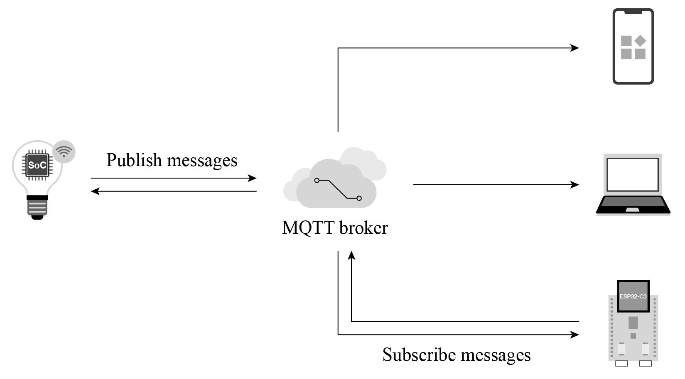
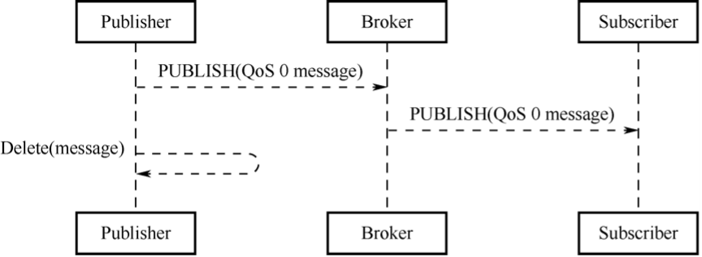
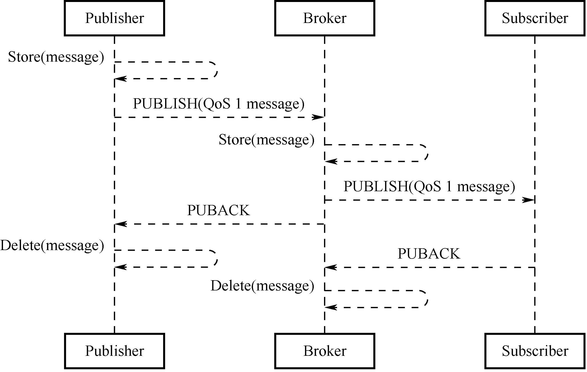
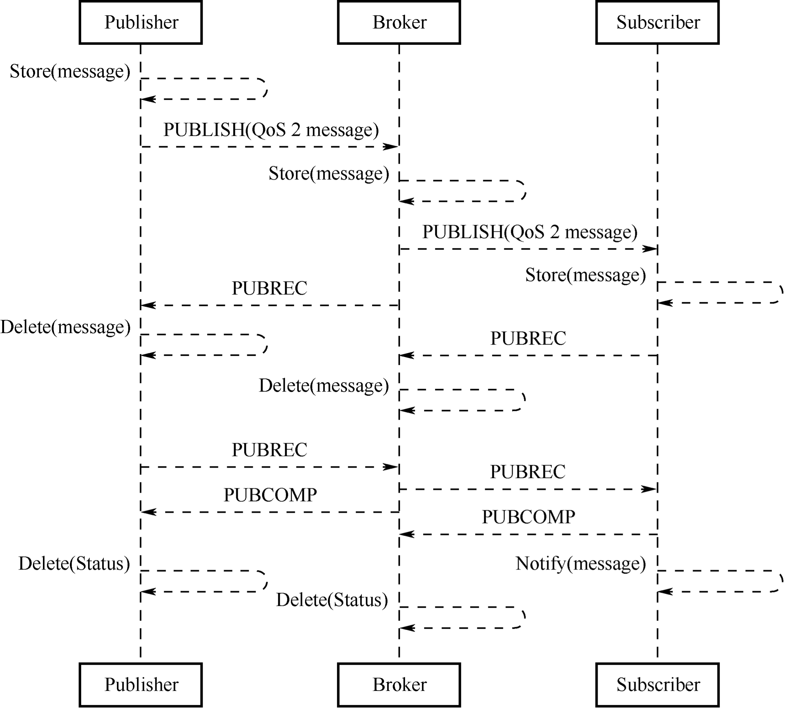

# 11.1 สถาปัตยกรรม Cloud Control และโปรโตคอล MQTT พื้นฐาน (Cloud Control & MQTT Architecture)

---

## 11.1.1 บทนำสู่การควบคุมระยะไกล (Introduction to Remote Control)

ในการพัฒนาอุปกรณ์ Internet of Things (IoT) การควบคุมและตรวจสอบสถานะการทำงานสามารถแบ่งออกเป็น 2 รูปแบบหลักตามขอบเขตของระบบเครือข่าย:

1. **การควบคุมภายในเครือข่ายท้องถิ่น (Local Control)**  
   ดังที่เราได้ศึกษาในสัปดาห์ที่ 10 การสื่อสารเกิดขึ้นภายในเครือข่ายแลน (LAN) เช่น การส่ง HTTP Request, UDP Packet หรือ CoAP ไปยังหมายเลข IP ท้องถิ่นของบอร์ดโดยตรง ซึ่งมีข้อดีคือมีความหน่วงเวลาต่ำมาก (Low Latency < 10 ms) และทำงานได้แม้โครงข่ายอินเทอร์เน็ตภายนอกจะล่ม ทว่ามีข้อจำกัดทางกายภาพที่เด่นชัด คือ **ผู้ใช้งานและอุปกรณ์ต้องเชื่อมต่ออยู่บนเครือข่าย Wi-Fi วงเดียวกันเท่านั้น**
2. **การควบคุมระยะไกลผ่านระบบคลาวด์ (Remote Control / Cloud Control)**  
   คือการที่อุปกรณ์หนึ่ง (เช่น สมาร์ตโฟน แท็บเล็ต หรือคอมพิวเตอร์) ควบคุมหรือรับส่งข้อมูลกับอุปกรณ์ IoT ปลายทางผ่านโครงข่ายบริเวณกว้าง (Wide Area Network - WAN หรืออินเทอร์เน็ต) โดยทลายข้อจำกัดด้านระยะทางและตำแหน่งทางภูมิศาสตร์ เช่น ผู้ใช้งานสามารถตรวจสอบอุณหภูมิห้องหรือสั่งเปิด-ปิดเครื่องปรับอากาศที่บ้านได้จากที่ทำงาน

```
+-----------------------------------------------------------------------------------+
|                            สถาปัตยกรรม Remote Cloud Control                        |
+-----------------------------------------------------------------------------------+

     [ สมาร์ตโฟน / แอปรวมศูนย์ ]                       [ อุปกรณ์ ESP32-C3 ปลายทาง ]
         (เครือข่ายมือถือ 4G/5G)                            (เครือข่าย Wi-Fi ภายในบ้าน)
                 │                                                    │
                 │ Outgoing Connection                                │ Outgoing Connection
                 ▼                                                    ▼
       ┌────────────────────────────────────────────────────────────────────┐
       │                 Cloud Server / MQTT Broker (Public IP)             │
       │               (เช่น Mosquitto, EMQX, AWS IoT Core)                 │
       │                                                                    │
       │    - จัดเก็บสถานะอุปกรณ์ (Device State / Shadow)                    │
       │    - คัดกรองและกระจายข้อความตามหัวข้อ (Message Routing by Topic)   │
       │    - รักษาความปลอดภัยและยืนยันตัวตน (Authentication & TLS)          │
       └────────────────────────────────────────────────────────────────────┘
```

### ทำไมระบบ Cloud Control ต้องมี Cloud Server คนกลาง
ในเครือข่ายอินเทอร์เน็ตตามบ้าน อุปกรณ์ ESP32 จะเชื่อมต่ออยู่หลังเราเตอร์ ซึ่งทำหน้าที่แปลงแอดเดรสผ่านระบบ **NAT (Network Address Translation)** และมีระบบไฟร์วอลล์ (Firewall) ป้องกันไม่ให้อุปกรณ์ภายนอกส่งแพ็กเก็ตตรงเข้ามายัง IP วงแลนได้ หากไม่มีเซิร์ฟเวอร์คนกลาง สมาร์ตโฟนจากภายนอกจะไม่สามารถส่งคำสั่งทะลุ NAT เข้ามาหา ESP32 ได้โดยตรง

ดังนั้น ในระบบ Cloud Control
* ทั้ง **สมาร์ตโฟน (Controlling Device)** และ **ESP32 (Controlled Device)** จะเป็นฝ่ายริเริ่มสร้างการเชื่อมต่อขาออก (Outbound TCP Connection) วิ่งขึ้นไปยัง **Cloud Server / Broker** ซึ่งมีหมายเลข Public IP หรือ Domain Name ถาวร
* การส่งข้อมูลและการกระจายคำสั่งทั้งหมดจะถูกจัดการและส่งต่อ (Forwarding) โดยคลาวด์เซิร์ฟเวอร์

### ตารางเปรียบเทียบ Local Control vs Cloud Control

| ปัจจัยเชิงเทคนิค                                | Local Control (LAN)                 | Cloud Control (WAN)                                    |
| :---------------------------------------------- | :---------------------------------- | :----------------------------------------------------- |
| **ขอบเขตพื้นที่ (Geographical Limit)**          | จำกัดเฉพาะเครือข่ายแลนเดียวกัน      | ไร้ขีดจำกัด เข้าถึงได้จากทุกที่ทั่วโลก                 |
| **ความหน่วงเวลา (Latency)**                     | ต่ำมาก (ระดับ 1–10 มิลลิวินาที)     | สูงกว่า (ขึ้นกับ RTT อินเทอร์เน็ต 50–300 มิลลิวินาที)  |
| **การพึ่งพาอินเทอร์เน็ต (Internet Dependency)** | ไม่พึ่งพา ทำงานได้แม้เน็ตตัด        | ต้องพึ่งพาอินเทอร์เน็ตทั้งฝั่งแอปและตัวอุปกรณ์         |
| **ค่าใช้จ่ายโครงสร้างพื้นฐาน**                  | ต่ำ (ไม่ต้องเช่าเซิร์ฟเวอร์ภายนอก)  | มีค่าใช้จ่าย Cloud Server / แบนด์วิดท์ข้อมูล           |
| **ความสะดวกของผู้ใช้งาน**                       | ต้องเชื่อมต่อ Wi-Fi บ้านก่อนสั่งงาน | สะดวกสบาย ตรวจสอบสถานะและสั่งการได้ตลอดเวลา            |
| **ความเสี่ยงด้านความปลอดภัย**                   | เสี่ยงเฉพาะผู้บุกรุกในวงแลน         | ต้องป้องกันการดักจับบนอินเทอร์เน็ต (จำเป็นต้องใช้ TLS) |

---

## 11.1.2 สถาปัตยกรรมและหลักการทำงานของ MQTT (MQTT Principles)

โปรโตคอลหลักที่นิยมใช้งานในการเชื่อมต่อระหว่างอุปกรณ์ IoT และ Cloud Server คือ **MQTT (Message Queue Telemetry Transport)** ถูกคิดค้นโดย Dr. Andy Stanford-Clark (IBM) และ Arlen Nipper (Arcom) ในปี 1999 และได้รับการรับรองเป็นมาตรฐานสากลโดย **OASIS** และ **ISO/IEC 20922**

MQTT ทำงานครอบอยู่บนโพรโทคอลระดับขนส่ง **TCP/IP** โดยใช้รูปแบบการสื่อสารแบบ **Publish/Subscribe (ผู้เผยแพร่ / ผู้บอกรับข้อมูล)** ซึ่งแตกต่างจากสถาปัตยกรรม Request/Response ของ HTTP อย่างสิ้นเชิง

<p align="center">
  
</p>
<p align="center"><b>รูปที่ 11.1</b> สถาปัตยกรรมของโปรโตคอล MQTT (Architecture of MQTT Protocol)</p>

### องค์ประกอบหลัก 3 ฝ่ายในระบบ MQTT
1. **ผู้เผยแพร่ข้อมูล (Publisher)**  
   อุปกรณ์หรือแอปพลิเคชันที่ส่งข้อความข้อมูล (Application Message) ขึ้นไปยังเซิร์ฟเวอร์ โดยจะแนบป้ายระบุหัวข้อที่เรียกว่า **Topic** ไปกับข้อความ เช่น ESP32 ส่งค่าอุณหภูมิไปยังหัวข้อ `sensors/temperature`
2. **ตัวกลางรับส่งข้อความ (Broker หรือ Server)**  
   เซิร์ฟเวอร์ส่วนกลางที่ทำหน้าที่รับการเชื่อมต่อจาก Client ทั้งหมด, จัดการสิทธิ์การเข้าถึง, รับข้อความจาก Publisher และคัดกรองส่งต่อข้อความ (Forward) ไปยัง Subscriber ทุกรายที่สมัครรับหัวข้อนั้นๆ ไว้อย่างถูกต้อง ตัวอย่างซอฟต์แวร์ Broker ได้แก่ **Eclipse Mosquitto**, **EMQX**, **HiveMQ** และ **AWS IoT Core**
3. **ผู้บอกรับข้อมูล (Subscriber)**  
   อุปกรณ์หรือแอปพลิเคชันที่ลงทะเบียนความสนใจ (Subscribe) ในหัวข้อที่ต้องการไว้กับ Broker เมื่อ Broker ได้รับข้อความใหม่ในหัวข้อดังกล่าว ก็จะผลักข้อมูล (Push) มาให้ Subscriber โดยอัตโนมัติ

> [!NOTE]
> ในมาตรฐาน MQTT ทั้ง Publisher และ Subscriber ต่างมีสถานะเป็น **Client** ทั้งคู่ โดยอุปกรณ์หนึ่งชิ้น (เช่น ESP32 หรือ Smartphone) สามารถทำหน้าที่เป็นทั้ง Publisher และ Subscriber พร้อมๆ กันได้ใน Client เดียวกัน

### คุณลักษณะเด่นของการสื่อสารแบบแยกส่วน (Decoupling)
ความเหนือกว่าของโมเดล Publish/Subscribe เมื่อเทียบกับ Request/Response คือการ **ตัดขาดความสัมพันธ์โดยตรงระหว่างโฮสต์ (Decoupling)** 3 ด้าน:
* **Space Decoupling (การแยกเชิงพื้นที่)**: Publisher และ Subscriber ไม่จำเป็นต้องทราบ IP Address หรือ Port ของกันและกัน ทั้งสองฝ่ายคุยกับ Broker เท่านั้น
* **Time Decoupling (การแยกเชิงเวลา)**: ไม่จำเป็นต้องทำงานพร้อมกัน หากตั้งค่า Retained Message หรือ Persistent Session ไว้ ผู้รับสามารถเปิดเครื่องขึ้นมารับข้อมูลย้อนหลังได้
* **Synchronization Decoupling (การแยกการประสานเวลา)**: การส่งข้อมูลเป็นแบบ Asynchronous ผู้ส่งไม่ต้องหยุดรอให้ผู้รับประมวลผลเสร็จสิ้น

---

## 11.1.3 ระบบหัวข้อและตัวกรองไวลด์การ์ด (Topics & Wildcards)

ใน MQTT ข้อความจะถูกจัดหมวดหมู่ผ่าน **Topic** ซึ่งเป็นสตริงข้อความแบบลำดับชั้น (Hierarchical String) คั่นแต่ละระดับด้วยเครื่องหมายทับ (`/`) เช่นเดียวกับโครงสร้างโฟลเดอร์ในระบบปฏิบัติการ
### กฎการตั้งชื่อ Topic
* มีความไวต่อตัวพิมพ์เล็ก-ใหญ่ (**Case Sensitive**): เช่น `Home/LivingRoom` แตกต่างจาก `home/livingroom`
* อนุญาตให้ใช้อักขระ UTF-8 รวมถึงช่องว่าง (แต่ในทางปฏิบัติแนะนำให้ใช้ตัวอักษรภาษาอังกฤษ ตัวเลข และเครื่องหมายขีดล่าง `_` เพื่อหลีกเลี่ยงข้อผิดพลาด)
* ไม่ควรขึ้นต้นด้วยเครื่องหมายทับ (`/`) เพราะจะทำให้เกิดระดับชั้นว่างเปล่าในระดับแรกโดยไม่จำเป็น (เช่น ใช้ `home/light` แทนที่จะเป็น `/home/light`)
* ห้ามใช้ Topic ที่ขึ้นต้นด้วย `$SYS/` เนื่องจากเป็นหัวข้อสงวนสำหรับข้อมูลภายในของ Broker (System Topics)

```
home/
 ├── bedroom/
 │    ├── light
 │    └── temperature
 └── livingroom/
      ├── light
      └── ac
```

### ตัวกรองไวลด์การ์ด (Wildcards) สำหรับการ Subscribe
เมื่อ Client ต้องการรับข้อความจากหลายหัวข้อพร้อมกัน MQTT กำหนดสัญลักษณ์ไวลด์การ์ด 2 รูปแบบ ซึ่งใช้ได้ **เฉพาะขั้นตอน Subscribe เท่านั้น (ห้ามใช้ในขั้นตอน Publish)**:

#### 1. ไวลด์การ์ดระดับเดียว (Single-Level Wildcard: `+`)
ใช้แทนชื่อระดับชั้นใดๆ ก็ได้ **เพียง 1 ระดับ** ณ ตำแหน่งนั้น
* ตัวอย่าง: `home/+/light`
  * แมตช์กับ: `home/bedroom/light`, `home/livingroom/light`, `home/kitchen/light`
  * **ไม่แมตช์** กับ: `home/bedroom/reading/light` (เพราะมี 2 ระดับชั้นคั่นกลาง)

#### 2. ไวลด์การ์ดหลายระดับ (Multi-Level Wildcard: `#`)
ใช้แทนชื่อระดับชั้นใดๆ ก็ได้ **ตั้งแต่ศูนย์ระดับขึ้นไปจนถึงปลายสุด** ของลำดับชั้น โดยสัญลักษณ์ `#` ต้องอยู่ **ท้ายสุด** ของ Topic Filter เสมอ
* ตัวอย่าง: `home/bedroom/#`
  * แมตช์กับ: `home/bedroom/light`, `home/bedroom/temperature`, `home/bedroom/ac/fan_speed` และ `home/bedroom`
* ตัวอย่าง: `#`
  * หมายถึงการรับข้อความ **ทุกหัวข้อที่มีอยู่ในระบบ Broker** (มักใช้สำหรับการ Debug หรือ Data Logger กลาง)

---

## 11.1.4 โครงสร้างแพ็กเก็ตของ MQTT (MQTT Message & Packet Format)

MQTT เป็นโปรโตคอลที่เน้นประสิทธิภาพการใช้แบนด์วิดท์ (Bandwidth-efficient) โครงสร้างแพ็กเก็ตควบคุม (Control Packet) ประกอบด้วย 3 องค์ประกอบหลัก

```
+───────────────────────────────────+─────────────────────────────────+─────────────────────────────────+
|     Fixed Header (ส่วนหัวคงที่)    |   Variable Header (ส่วนหัวแปรผัน) |         Payload (เนื้อข้อมูล)   |
|          (ขนาด 2 - 5 ไบต์)         |         (มีเฉพาะบางแพ็กเก็ต)     |       (มีเฉพาะบางแพ็กเก็ต)      |
+───────────────────────────────────+─────────────────────────────────+─────────────────────────────────+
```

<p align="center">
  
</p>
<p align="center"><b>รูปที่ 11.2</b> โครงสร้าง Fixed Header ของแพ็กเก็ตควบคุม MQTT (Fixed Header of Control Packet)</p>

### 1. ส่วนหัวคงที่ (Fixed Header)
ทุกแพ็กเก็ตของ MQTT จะต้องมี Fixed Header โดยมีขนาดเริ่มต้นเพียง **2 ไบต์**
* **Byte 1**
  * **Bit 7–4 (MQTT Control Packet Type)**: ระบุประเภทแพ็กเก็ต (4 บิต รวมได้ 16 ประเภท โดยมาตรฐานใช้ 14 ประเภท)
  * **Bit 3–0 (Flags specific to each packet type)**: แฟล็กควบคุมเฉพาะ เช่น DUP (ส่งซ้ำ), QoS (ระดับบริการ), RETAIN (บันทึกสถานะล่าสุด)
* **Byte 2 ถึง 5 (Remaining Length)**
  ระบุขนาดความยาวของข้อมูลที่เหลือในแพ็กเก็ต (รวม Variable Header และ Payload) โดยใช้การเข้ารหัสแบบความยาวแปรผัน (Variable Length Encoding)

#### ตารางที่ 11.1 ประเภทของแพ็กเก็ตควบคุม MQTT (MQTT Control Packet Types)

| ค่าฐาน 16 (Hex) | ชื่อแพ็กเก็ต  | ทิศทางการส่ง      | หน้าที่และการทำงาน                                  |
| :-------------: | :------------ | :---------------- | :-------------------------------------------------- |
|     **0x1**     | `CONNECT`     | Client -> Server  | ร้องขอการเชื่อมต่อเครือข่ายเข้าสู่ Broker           |
|     **0x2**     | `CONNACK`     | Server -> Client  | ตอบรับการยืนยันสถานะการเชื่อมต่อสำเร็จ/ล้มเหลว      |
|     **0x3**     | `PUBLISH`     | Client <-> Server | เผยแพร่ข้อความข้อมูลพร้อมเนื้อหา Payload            |
|     **0x4**     | `PUBACK`      | Client <-> Server | ตอบรับการได้รับข้อความ PUBLISH (สำหรับ QoS 1)       |
|     **0x5**     | `PUBREC`      | Client <-> Server | ตอบรับขั้นที่ 1 ในการรับข้อความ (สำหรับ QoS 2)      |
|     **0x6**     | `PUBREL`      | Client <-> Server | สั่งปลดปล่อยข้อความขั้นที่ 2 (สำหรับ QoS 2)         |
|     **0x7**     | `PUBCOMP`     | Client <-> Server | ตอบรับการส่งข้อมูลเสร็จสมบูรณ์ขั้นสุดท้าย (QoS 2)   |
|     **0x8**     | `SUBSCRIBE`   | Client -> Server  | ร้องขอการบอกรับข้อมูลใน Topic ที่กำหนด              |
|     **0x9**     | `SUBACK`      | Server -> Client  | ตอบรับผลการ Subscribe พร้อมแจ้งสิทธิ์ QoS ที่ได้รับ |
|     **0xA**     | `UNSUBSCRIBE` | Client -> Server  | ขอยกเลิกการบอกรับข้อมูลใน Topic                     |
|     **0xB**     | `UNSUBACK`    | Server -> Client  | ตอบรับการยกเลิกการบอกรับข้อมูลสำเร็จ                |
|     **0xC**     | `PINGREQ`     | Client -> Server  | ส่งสัญญาณชีพ (Heartbeat / Keep-Alive Request)       |
|     **0xD**     | `PINGRESP`    | Server -> Client  | ตอบรับสัญญาณชีพ เพื่อยืนยันว่าลิงก์ยังไม่ขาด        |
|     **0xE**     | `DISCONNECT`  | Client -> Server  | ขอตัดการเชื่อมต่ออย่างสงบ (Graceful Disconnect)     |

#### การเข้ารหัสความยาวที่เหลือ (Remaining Length Encoding Scheme)
Remaining Length ใช้ระบบ **7-bit Base-128 Encoding** โดยแต่ละไบต์
* บิต 0 ถึง 6 ใช้เก็บค่าตัวเลข (0 ถึง 127)
* บิต 7 (MSB) คือ **Continuation Bit** (ถ้าเป็น `1` แปลว่ามีไบต์ความยาวถัดไป, ถ้าเป็น `0` แปลว่าสิ้นสุดฟิลด์ความยาว)

|  จำนวนไบต์  | ค่าต่ำสุด                          | ค่าสูงสุด                            | ขนาดข้อมูลที่รองรับได้        |
| :---------: | :--------------------------------- | :----------------------------------- | :---------------------------- |
| **1 Byte**  | 0 (0x00)                           | 127 (0x7F)                           | 127 ไบต์ (~128 B)             |
| **2 Bytes** | 128 (0x80, 0x01)                   | 16,383 (0xFF, 0x7F)                  | 16 กิโลไบต์ (~16 KB)          |
| **3 Bytes** | 16,384 (0x80, 0x80, 0x01)          | 2,097,151 (0xFF, 0xFF, 0x7F)         | 2 เมกะไบต์ (~2 MB)            |
| **4 Bytes** | 2,097,152 (0x80, 0x80, 0x80, 0x01) | 268,435,455 (0xFF, 0xFF, 0xFF, 0x7F) | สูงสุด 256 เมกะไบต์ (~256 MB) |

---

## 11.1.5 ระดับคุณภาพการให้บริการ (Quality of Service - QoS)

จุดแข็งสำคัญของ MQTT คือการเปิดให้นักพัฒนากำหนด **ระดับคุณภาพการส่งมอบข้อความ (Quality of Service - QoS)** ได้อย่างอิสระตามความสำคัญของข้อมูล โดยมี 3 ระดับ

### 1. QoS 0 --  At most once delivery ("ส่งครั้งเดียว ไม่การันตีผล")
* ข้อความจะถูกส่งไปเพียงครั้งเดียวตามความสามารถของ TCP/IP
* ไม่มีการส่งแพ็กเก็ตตอบรับ (No ACK) และไม่มีการส่งซ้ำ
* ข้อความอาจสูญหายได้หากเครือข่ายขัดข้อง
* **ข้อดี**: ใช้แบนด์วิดท์น้อยที่สุด มีความหน่วงเวลาต่ำสุด
* **เหมาะสำหรับ**: ข้อมูลสตรีมมิ่งที่ส่งถี่ๆ เช่น ข้อมูลตำแหน่ง GPS, ข้อมูล Telemetry อุณหภูมิที่อัปเดตทุก 2 วินาที (หากหายไป 1 ครั้ง ข้อมูลรอบถัดไปก็มาแทนที่ได้)

<p align="center">
  
</p>
<p align="center"><b>รูปที่ 11.3</b> ลำดับการส่งแพ็กเก็ตของ MQTT QoS 0 (Flow of MQTT QoS 0)</p>

### 2. QoS 1 -- At least once delivery ("ส่งถึงผู้รับอย่างน้อยหนึ่งครั้ง")
* ผู้ส่งจะแนบหมายเลขแพ็กเก็ต **Packet Identifier (Packet ID)** ไปกับแพ็กเก็ต `PUBLISH`
* ผู้รับต้องตอบกลับด้วยแพ็กเก็ต `PUBACK` พร้อมระบุ Packet ID เดียวกัน
* หากผู้ส่งไม่ได้รับ `PUBACK` ภายในระยะเวลา Time-out ผู้ส่งจะทำการ **ส่งซ้ำ (Retransmit)** โดยจะเปิดบิต **DUP (Duplicate Flag) = 1** ใน Fixed Header
* **ข้อควรระวัง**: อาจเกิดข้อความซ้ำซ้อน (Duplicate Messages) ได้หากเครือข่ายหน่วงและผู้ส่งเข้าใจผิดว่าข้อความตกหล่น
* **เหมาะสำหรับ**: การแจ้งเตือนเตือนภัย (Alarm/Event), สถานะเปิด-ปิดไฟที่จำเป็นต้องไปถึงแน่นอน

<p align="center">
  
</p>
<p align="center"><b>รูปที่ 11.4</b> ลำดับการส่งแพ็กเก็ตของ MQTT QoS 1 (Flow of MQTT QoS 1)</p>

### 3. QoS 2 -- Exactly once delivery ("ส่งถึงผู้รับครั้งเดียวแน่นอน ไม่ขาดและไม่เกิน")
* เป็นระดับความปลอดภัยสูงสุด ใช้กระบวนการตรวจสอบแบบ 4 ขั้นตอน (Four-step Handshake)
  1. ผู้ส่งส่ง `PUBLISH` (พร้อม Packet ID)
  2. ผู้รับบันทึกข้อความและตอบกลับด้วย `PUBREC` (Publish Received)
  3. ผู้ส่งส่ง `PUBREL` (Publish Release) เพื่อแจ้งให้ผู้รับประมวลผลข้อความได้
  4. ผู้รับประมวลผลเสร็จแล้วตอบกลับด้วย `PUBCOMP` (Publish Complete) เพื่อปิดกระบวนการ
* รับประกันว่าข้อความจะไม่สูญหายและไม่เกิดการซ้ำซ้อนเด็ดขาด
* **ข้อเสีย**: มีขั้นตอน Overhead มากที่สุด และความหน่วงเวลาสูงสุด
* **เหมาะสำหรับ**: ธุรกรรมทางการเงิน (Billing), ระบบล็อกประตูนิรภัย, คำสั่งยิงสัญญาณระบบดับเพลิง

<p align="center">
  
</p>
<p align="center"><b>รูปที่ 11.5</b> ลำดับการส่งแพ็กเก็ตของ MQTT QoS 2 (Flow of MQTT QoS 2)</p>

---

## 11.1.6 คุณสมบัติขั้นสูงของ MQTT

### 1. ข้อความคงค้าง (Retained Messages)
โดยปกติ Broker จะส่งต่อข้อความให้เฉพาะ Subscriber ที่กำลังออนไลน์อยู่ขณะนั้น หากมี Subscriber ใหม่เพิ่งเชื่อมต่อเข้ามาในภายหลัง Subscriber นั้นจะยังไม่ได้รับข้อมูลใดๆ จนกว่า Publisher จะส่งรอบใหม่

หาก Publisher เปิดแฟล็ก **`RETAIN = 1`** ในแพ็กเก็ต `PUBLISH`
* Broker จะจัดเก็บข้อความล่าสุดของ Topic นั้นไว้ในหน่วยความจำ
* ทันทีที่มี Subscriber รายใหม่กด Subscribe หัวข้อนั้น Broker จะผลักข้อความ Retained ล่าสุดนี้ไปให้ทันทีโดยไม่ต้องรอให้เซนเซอร์วัดค่าใหม่
* เหมาะสำหรับ: สถานะปัจจุบันของสวิตช์ไฟ (`home/light/state` = `ON`), เวอร์ชันเฟิร์มแวร์ปัจจุบัน

### 2. ตัวจับเวลาสัญญาณชีพ (Keep-Alive & Heartbeat)
* ในขั้นตอนส่ง `CONNECT` ไคลเอนต์จะกำหนดค่า **Keep Alive Timer** (เช่น 60 วินาที)
* หากช่วงเวลาดังกล่าวไม่มีการส่งข้อความข้อมูล Client จะส่งแพ็กเก็ตขนาด 2 ไบต์ชื่อ **`PINGREQ`** ไปยัง Broker
* Broker จะตอบกลับด้วย **`PINGRESP`**
* หาก Broker ไม่ได้รับข้อมูลหรือ PINGREQ นานเกิน 1.5 เท่าของ Keep-Alive (90 วินาที) Broker จะถือว่าไคลเอนต์นั้นขาดการติดต่อ (Dead Connection) และจะตัดการเชื่อมต่อทันที

### 3. พินัยกรรมฉุกเฉิน (Last Will and Testament - LWT)
ในระบบ IoT อุปกรณ์ฝังตัวอาจไฟดับ ถูกถอดปลั๊ก หรือสัญญาณ Wi-Fi หลุดกะทันหันโดยไม่ได้ส่งแพ็กเก็ต `DISCONNECT`
* ในขั้นตอน `CONNECT` ไคลเอนต์สามารถลงทะเบียน **LWT Topic**, **LWT Message** (เช่น `"offline"`) และ **LWT QoS** ไว้ล่วงหน้า
* หาก Broker ตรวจพบว่าไคลเอนต์หลุดการเชื่อมต่ออย่างผิดปกติ (Abnormal Disconnect หรือ Keep-Alive ขาดหาย) **Broker จะเป็นผู้ Publish ข้อความ LWT นี้ไปยังหัวข้อที่ระบุให้โดยอัตโนมัติ**
* ทำให้ผู้ใช้งานในแอปพลิเคชันหรือ Dashboard ทราบทันทีว่าอุปกรณ์ออฟไลน์ไปแล้ว

```
[ Client ESP32 ]                          [ Broker ]                         [ Dashboard App ]
       │                                      │                                      │
       │── CONNECT (Will: device/status="offline") ──>                                │
       │                                      │                                      │
       │  (ESP32 ถูกถอดปลั๊กกะทันหัน)          │                                      │
       X                                      │ (Keep-Alive ขาดหาย)                  │
                                              │── PUBLISH ("device/status", "offline") ──>
                                              │                                      │ (แสดงผล: DISCONNECTED)
```

---

## 11.1.7 การเปรียบเทียบเชิงวิศวกรรม MQTT vs HTTP vs CoAP

| คุณสมบัติ                  | MQTT (RFC ISO/IEC 20922)           | HTTP/1.1 (REST API)               | CoAP (RFC 7252)                     |
| :------------------------- | :--------------------------------- | :-------------------------------- | :---------------------------------- |
| **สถาปัตยกรรม**            | Publish / Subscribe                | Client / Server (Req/Resp)        | REST-like (Req/Resp, Observe)       |
| **โปรโตคอลขนส่ง**          | **TCP**                            | **TCP**                           | **UDP**                             |
| **ขนาด Fixed Header**      | **2 ไบต์**                         | ตัวอักษร Text (> 100 ไบต์)        | **4 ไบต์**                          |
| **การเชื่อมต่อข้าม NAT**   | ทำงานได้ง่าย (Client ต่อหา Broker) | ลำบาก (Device เป็น Server ไม่ได้) | ลำบากหากข้าม WAN (ต้องการ Relay)    |
| **การกระจายแบบ 1 ต่อ N**   | มีประสิทธิภาพสูงมากในตัว           | ต้องวนส่ง Request แยกทีละเครื่อง  | รองรับ Multicast ภายในวงแลน         |
| **ระดับความน่าเชื่อถือ**   | QoS 0, 1, 2 ตามเลือก               | รับประกันตามสแตก TCP              | CON (Confirmable) / NON             |
| **การแจ้งเตือนสถานะขาด**   | รองรับ LWT ในตัว                   | ไม่มี                             | ไม่มี                               |
| **การเข้ารหัสความปลอดภัย** | TLS (พอร์ต 8883)                   | TLS/HTTPS (พอร์ต 443)             | DTLS (พอร์ต 5684)                   |
| **กรณีการใช้งานหลัก**      | Cloud Telemetry & IoT Control      | Web Portal, REST Config           | พลังงานต่ำมากใน Sensor เครือข่ายปิด |

---

## สรุป
โปรโตคอล **MQTT** ถูกออกแบบมาเพื่อแก้ปัญหาคอขวดของการสื่อสารผ่านเครือข่าย WAN สำหรับอุปกรณ์ IoT สมองกลฝังตัว ด้วยการผสานโมเดล **Publish/Subscribe**, สแตก **TCP**, ส่วนหัวขนาดกะทัดรัด, การแยกระบบเชิงพื้นที่และเวลา (Decoupling) รวมถึงกลไกการันตี **QoS** และ **LWT** ทำให้อุปกรณ์สามารถทำงานข้ามระบบคลาวด์ได้อย่างมีเสถียรภาพและยืดหยุ่นสูง
