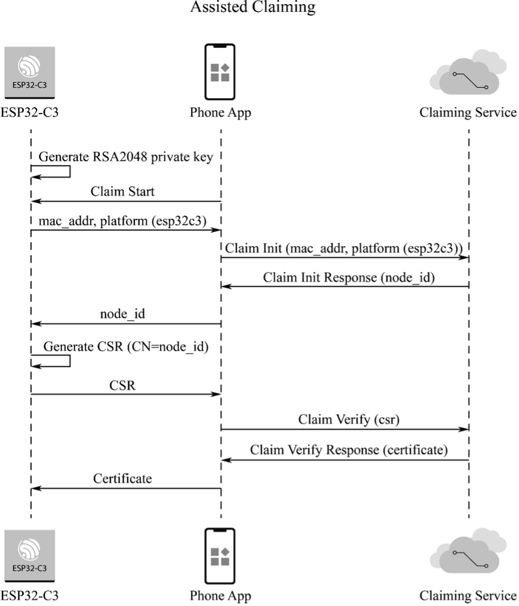
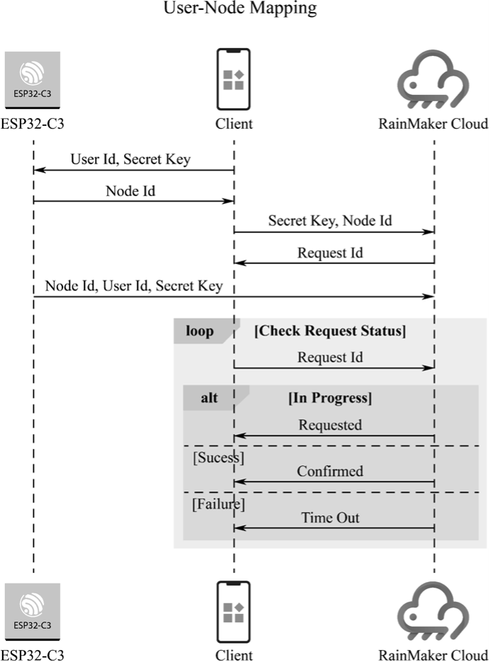
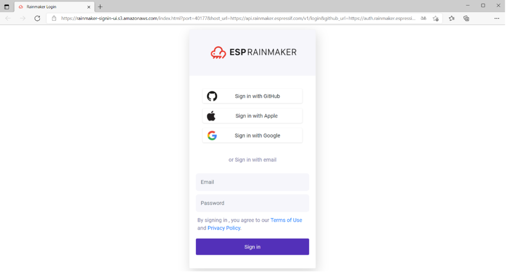
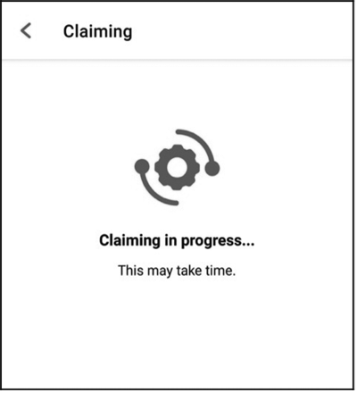
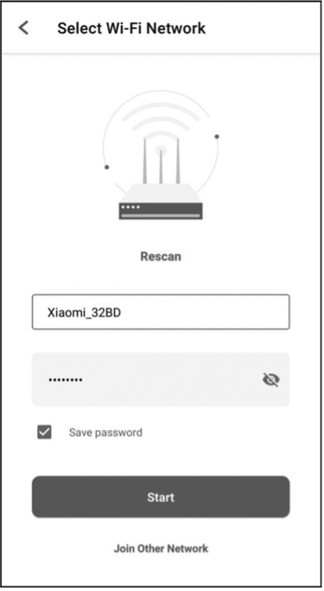
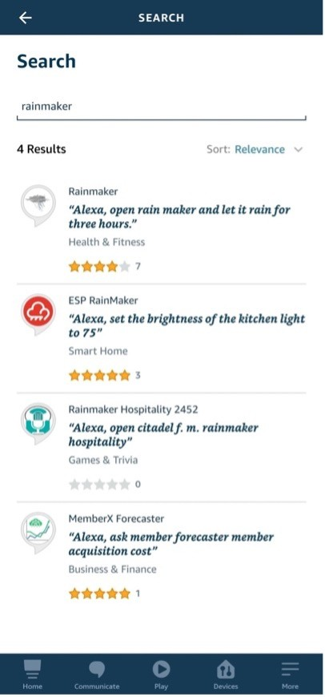
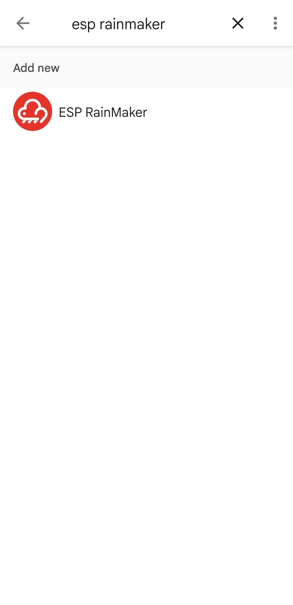

# 11.4 แพลตฟอร์มคลาวด์ ESP RainMaker และระบบนิเวศ IoT อัจฉริยะ (ESP RainMaker Platform & Ecosystem)

---

## 11.4.1 พื้นฐานและสถาปัตยกรรมของ ESP RainMaker (ESP RainMaker Basics)

แม้ว่าเราจะสามารถสร้างระบบ MQTT และเซิร์ฟเวอร์ Broker ขึ้นมาเองได้ แต่ในการพัฒนาผลิตภัณฑ์ IoT เชิงพาณิชย์ วิศวกรจะต้องเผชิญกับภาระงานมหาศาลในการสร้างโครงสร้างพื้นฐานรอบด้าน เช่น การพัฒนาระบบคลาวด์แบ็กเอนด์ที่รองรับการขยายตัว (Scalable Cloud), การผูกอุปกรณ์กับบัญชีผู้ใช้ (User-Device Mapping), การพัฒนาแอปพลิเคชันบนมือถือทั้ง iOS และ Android, การอัปเดตเฟิร์มแวร์ทางอากาศ (OTA) ตลอดจนการเชื่อมต่อกับระบบผู้ช่วยอัจฉริยะ (Voice Assistants)

เพื่อลดความซับซ้อนดังกล่าว **Espressif Systems** จึงได้พัฒนาแพลตฟอร์มแบบครบวงจร (End-to-End IoT Solution) ในชื่อ **ESP RainMaker** ซึ่งผสานฮาร์ดแวร์ คลาวด์ และแอปพลิเคชันเข้าด้วยกันอย่างสมบูรณ์

<p align="center">
  
</p>
<p align="center"><b>รูปที่ 11.6</b> สถาปัตยกรรมของเฟรมเวิร์ก ESP RainMaker (ESP RainMaker Framework)</p>

### องค์ประกอบหลัก 4 ส่วนของ ESP RainMaker
1. **Device Firmware (ESP-IDF + RainMaker SDK)**:  
   เฟิร์มแวร์ที่ทำงานบนชิป ESP32/ESP32-C3 ทำหน้าที่ควบคุมฮาร์ดแวร์ จัดการ Wi-Fi Provisioning ผ่าน BLE และสื่อสารกับคลาวด์ผ่าน MQTTS
2. **Cloud Backend (Serverless Architecture on AWS)**:  
   ระบบคลาวด์เบื้องหลังสร้างขึ้นบนโครงสร้างพื้นฐานระดับโลกของ **Amazon Web Services (AWS)** โดยใช้ AWS IoT Core เป็นตัวกลางกระจายข้อความ MQTT, AWS Cognito จัดการระบบสมาชิก, AWS DynamoDB เก็บฐานข้อมูล และ AWS Lambda จัดการตรรกะแบบ Serverless
3. **Phone Application (ESP RainMaker Mobile App)**:  
   แอปพลิเคชันบน iOS และ Android สำหรับผู้ใช้งานทั่วไป ใช้ค้นหาอุปกรณ์ผ่านบลูทูธ (BLE), ส่งรหัส Wi-Fi (Provisioning), ผูกอุปกรณ์เข้ากับบัญชีตนเอง และควบคุมเปิด-ปิดหรือปรับค่าต่างๆ ผ่านหน้าจอแบบ Dynamic UI
4. **Command Line Interface (ESP RainMaker CLI)**:  
   เครื่องมือแบบบรรทัดคำสั่ง (Python CLI) สำหรับนักพัฒนาในการดีบัก ดึงสถานะอุปกรณ์ ส่งคำสั่งควบคุม และบริหารจัดการผู้ใช้งาน

---

## 11.4.2 แบบจำลองข้อมูลอุปกรณ์ (Data Model: Node, Device, Param, Service)

ESP RainMaker ออกแบบโครงสร้างข้อมูลของอุปกรณ์แบบเป็นลำดับชั้น (Hierarchical Data Model) ซึ่งมีความยืดหยุ่นสูงมาก:

```
┌──────────────────────────────────────────────────────────────────────────────────┐
│                              Node (โหนด: บอร์ด ESP32 1 บอร์ด)                    │
│                              Node ID: "nq8xT6p53BZHTm6k8AZqN"                    │
│                                                                                  │
│  ├── [ Services ] (บริการระดับระบบ)                                              │
│  │     ├── Time Service (SNTP Sync)                                              │
│  │     ├── OTA Service (Firmware Upgrade)                                        │
│  │     └── Schedule Service (ตั้งเวลาทำงาน)                                      │
│  │                                                                               │
│  └── [ Devices ] (อุปกรณ์ตรรกะ)                                                  │
│        ├── Device 1: "Ceiling Light" (ประเภท: esp.device.lightbulb)              │
│        │     ├── Param: "Power"       (Type: esp.param.power,      Value: true)  │
│        │     ├── Param: "Brightness"  (Type: esp.param.brightness, Value: 80)    │
│        │     ├── Param: "Hue"         (Type: esp.param.hue,        Value: 120)   │
│        │     └── Param: "Saturation"  (Type: esp.param.saturation, Value: 100)   │
│        │                                                                         │
│        └── Device 2: "Living Room Sensor" (ประเภท: esp.device.sensor)            │
│              └── Param: "Temperature" (Type: esp.param.temperature, Value: 27.5) │
└──────────────────────────────────────────────────────────────────────────────────┘
```

1. **Node (โหนด)**:  
   คือตัวแทนของไมโครคอนโทรลเลอร์ ESP32 หนึ่งตัว ซึ่งจะได้รับหมายเลขระบุตัวตนเฉพาะ (**Node ID**) จากคลาวด์ บอร์ดหนึ่งตัวถือเป็นหนึ่ง Node
2. **Device (อุปกรณ์)**:  
   คือฟังก์ชันการทำงานทางตรรกะของเครื่องใช้ไฟฟ้า เช่น หลอดไฟ พัดลม สวิตช์ หรือเซนเซอร์ โดยหนึ่ง Node สามารถประกอบด้วยหลาย Device ได้ (เช่น บอร์ดเดียวคุมหลอดไฟ 2 ดวงและพัดลม 1 ตัว)
3. **Parameter (พารามิเตอร์)**:  
   คือคุณลักษณะหรือสถานะย่อยของ Device ที่สามารถอ่านหรือเขียนค่าได้ เช่น สถานะเปิด/ปิด (Power), ความสว่าง (Brightness), สี (Hue/Saturation), หรือค่าอุณหภูมิ (Temperature)
4. **Service (บริการส่วนกลาง)**:  
   คือฟังก์ชันการทำงานระดับระบบที่ไม่ผูกติดกับ Device ใด Device หนึ่ง เช่น บริการซิงก์เวลาโลก (Time Service), การอัปเดตเฟิร์มแวร์ (OTA Service) และการตั้งเวลาทำงานล่วงหน้า (Schedule Service)

---

## 11.4.3 โปรโตคอลการสื่อสารและระบบสิทธิ์ (Claiming Mechanism & Security)

ในระบบ IoT การที่อุปกรณ์ตัวใหม่จะได้รับอนุญาตให้เชื่อมต่อเข้ากับ AWS IoT Core ได้อย่างปลอดภัย จำเป็นต้องมี **ใบรับรองดิจิทัลและกุญแจเฉพาะตัว (Device Certificate & Private Key)** ฝังอยู่ในตัวบอร์ด กระบวนการขอรับและติดตั้งใบรับรองนี้เรียกว่า **Device Claiming**

<p align="center">
  
</p>
<p align="center"><b>รูปที่ 11.7</b> กระบวนการ Assisted Claiming ของ ESP32-C3 (ESP32-C3 Assisted Claiming)</p>

### วิธีการ Claiming ของ ESP RainMaker
1. **Assisted Claiming (การเคลมผ่านสมาร์ตโฟน)**:  
   เหมาะอย่างยิ่งสำหรับขั้นตอนการเรียนรู้และการพัฒนาผลิตภัณฑ์ต้นแบบ บอร์ด ESP32 ไม่จำเป็นต้องมีใบรับรองฝังมาล่วงหน้า ในระหว่างที่ผู้ใช้เปิดแอปมือถือเพื่อเชื่อมต่อ Wi-Fi แอปบนสมาร์ตโฟนจะติดต่อกับ RainMaker Cloud เพื่อขอรับ Certificate ชั่วคราว จากนั้นจะส่งต่อ Certificate ผ่านท่อบลูทูธ (BLE) ไปให้บอร์ด ESP32 บันทึกลงในหน่วยความจำ NVS Flash โดยอัตโนมัติ
2. **Self Claiming**:  
   บอร์ด ESP32 ที่เชื่อมต่ออินเทอร์เน็ตได้แล้วจะทำการร้องขอ Certificate จาก Claiming Server ของ Espressif โดยตรง
3. **Host-driven Claiming (Factory Claiming)**:  
   นำไปใช้ในสายการผลิตจริง โดยฝ่ายผลิตจะสร้าง Certificate แล้วเบิร์นลงในพาร์ติชันพิเศษชื่อ `fctry` บน Flash Memory ของแต่ละชิปตั้งแต่ขั้นตอนการผลิต

<p align="center">
  
</p>
<p align="center"><b>รูปที่ 11.8</b> กระบวนการผูกบัญชีผู้ใช้กับอุปกรณ์ (User-Node Association Mapping)</p>

เมื่ออุปกรณ์ได้รับ Certificate และเชื่อมต่อเข้ากับเราเตอร์ Wi-Fi สำเร็จ ตัวอุปกรณ์จะสร้างช่องทาง MQTTS ไปยัง Cloud Backend จากนั้นจะส่งข้อความ **User-Node Association** ซึ่งประกอบด้วย `User ID` และ `Secret Key` ที่ได้รับมาจากแอปพลิเคชันมือถือ เพื่อให้คลาวด์ทำการผูกอุปกรณ์ตัวนี้เข้ากับบัญชีของผู้ใช้อย่างถาวร

---

## 11.4.4 การสื่อสารผ่านเครื่องมือ ESP RainMaker CLI (`rainmaker.py`)

Espressif มีเครื่องมือ CLI ในภาษา Python สำหรับการทดสอบและสั่งการคลาวด์โดยไม่ต้องเปิดแอปมือถือ:

### 1. การติดตั้งเครื่องมือ CLI
```bash
pip install esp-rainmaker-cli
```

### 2. การเข้าสู่ระบบ (Login)
```bash
rainmaker.py login
```
คำสั่งจะทำการเปิดเว็บเบราว์เซอร์อัตโนมัติเพื่อให้ผู้ใช้ยืนยันการเข้าสู่ระบบผ่าน OAuth

<p align="center">
  
</p>
<p align="center"><b>รูปที่ 11.9</b> หน้าต่างยืนยันการเข้าสู่ระบบ ESP RainMaker ผ่านเบราว์เซอร์</p>

### 3. คำสั่ง CLI ที่สำคัญ (อ้างอิงตารางที่ 9.4 ในหนังสือ)

| คำสั่ง | หน้าที่การทำงาน | ตัวอย่างคำสั่ง |
| :--- | :--- | :--- |
| `rainmaker.py getnodes` | แสดงรายชื่อ Node ID ทั้งหมดที่ผูกกับบัญชีผู้ใช้ | `rainmaker.py getnodes` |
| `rainmaker.py getnodeconfig` | ดึงโครงสร้างข้อมูล JSON ของ Node (Device & Params) | `rainmaker.py getnodeconfig --nodeid <ID>` |
| `rainmaker.py getparams` | อ่านค่าสถานะปัจจุบันของทุกพารามิเตอร์ | `rainmaker.py getparams --nodeid <ID>` |
| `rainmaker.py setparams` | ส่งคำสั่งแก้ไขพารามิเตอร์ (สั่งงานอุปกรณ์) | `rainmaker.py setparams --nodeid <ID> '{"Light": {"Power": true, "Brightness": 70}}'` |
| `rainmaker.py otasync` | สั่งอัปเดตเฟิร์มแวร์ผ่านระบบ OTA จากระยะไกล | `rainmaker.py otasync --nodeid <ID> --fw-version 1.1` |

---

## 11.4.5 การพัฒนาตัวอย่าง Smart Light บน ESP-IDF

ด้านล่างนี้คือโครงสร้างโค้ดเฟิร์มแวร์มาตรฐานสำหรับการสร้างอุปกรณ์หลอดไฟอัจฉริยะ (Smart Light) ด้วย **ESP RainMaker SDK**:

### 1. การสร้าง Write Callback รับคำสั่งจากคลาวด์
เมื่อผู้ใช้กดเปลี่ยนสถานะในแอปหรือส่งคำสั่งผ่านคลาวด์ ฟังก์ชัน Callback นี้จะถูกเรียกทำงาน:

```c
#include "esp_rmaker_core.h"
#include "esp_rmaker_standard_types.h"
#include "esp_rmaker_standard_params.h"
#include "esp_rmaker_standard_devices.h"
#include "esp_log.h"
#include "driver/gpio.h"

#define LED_PIN GPIO_NUM_8
static const char *TAG = "APP_LIGHT";

static esp_err_t write_cb(const esp_rmaker_device_t *device, const esp_rmaker_param_t *param,
                          const esp_rmaker_param_val_t val, void *priv_data, esp_rmaker_write_ctx_t *ctx)
{
    if (ctx) {
        ESP_LOGI(TAG, "Received write request via: %s", esp_rmaker_device_cb_src_to_str(ctx->src));
    }
    const char *param_name = esp_rmaker_param_get_name(param);

    // ตรวจสอบพารามิเตอร์ Power (เปิด/ปิด)
    if (strcmp(param_name, ESP_RMAKER_DEF_POWER_NAME) == 0) {
        ESP_LOGI(TAG, "Updating Light Power to: %s", val.val.b ? "ON" : "OFF");
        gpio_set_level(LED_PIN, val.val.b ? 1 : 0);
        // รายงานสถานะใหม่กลับไปยังคลาวด์
        esp_rmaker_param_update_and_report(param, val);
    } 
    // ตรวจสอบพารามิเตอร์ Brightness (ความสว่าง 0-100%)
    else if (strcmp(param_name, ESP_RMAKER_DEF_BRIGHTNESS_NAME) == 0) {
        ESP_LOGI(TAG, "Updating Brightness to: %d%%", val.val.i);
        // ในฮาร์ดแวร์จริงจะนำค่าไปปรับ Duty Cycle ของ PWM
        esp_rmaker_param_update_and_report(param, val);
    }

    return ESP_OK;
}
```

---

### 2. การสร้าง Node, Device และเปิดใช้งานระบบ (Initialization)

```c
void app_main(void)
{
    // 1. กำหนดค่าฮาร์ดแวร์
    gpio_reset_pin(LED_PIN);
    gpio_set_direction(LED_PIN, GPIO_MODE_OUTPUT);

    // 2. เริ่มต้น RainMaker Node
    esp_rmaker_config_t rainmaker_cfg = {
        .enable_time_sync = true,
    };
    esp_rmaker_node_t *node = esp_rmaker_node_init(&rainmaker_cfg, "Smart Light Node", "Lightbulb");

    // 3. สร้าง Standard Lightbulb Device
    esp_rmaker_device_t *light_device = esp_rmaker_lightbulb_device_create("Ceiling Light", NULL, false);
    esp_rmaker_device_add_cb(light_device, write_cb, NULL);

    // 4. เพิ่ม Parameter มาตรฐาน: Brightness, Hue, Saturation
    esp_rmaker_device_add_param(light_device, esp_rmaker_brightness_param_create(ESP_RMAKER_DEF_BRIGHTNESS_NAME, 100));
    esp_rmaker_device_add_param(light_device, esp_rmaker_hue_param_create(ESP_RMAKER_DEF_HUE_NAME, 0));
    esp_rmaker_device_add_param(light_device, esp_rmaker_saturation_param_create(ESP_RMAKER_DEF_SATURATION_NAME, 100));

    // 5. บรรจุ Device เข้าสู่ Node
    esp_rmaker_node_add_device(node, light_device);

    // 6. เปิดบริการระบบ: Time Service, Schedule, และ OTA
    esp_rmaker_timezone_service_enable();
    esp_rmaker_schedule_enable();
    esp_rmaker_ota_config_t ota_config = {
        .server_cert = NULL, // ใช้ default cloud cert
    };
    esp_rmaker_ota_enable(&ota_config, OTA_USING_PARAMS);

    // 7. เริ่มต้นการทำงานของ RainMaker Core
    esp_rmaker_start();

    // 8. เริ่มต้นระบบ Wi-Fi Provisioning ผ่าน BLE
    // เมื่อบอร์ดเริ่มทำงาน จะแสดง QR Code ออกมาทาง Serial Monitor 
    // เพื่อให้ผู้ใช้ใช้แอปบนมือถือสแกนเชื่อมต่อและทำการ Assisted Claiming
}
```

---

## 11.4.6 ขั้นตอนการจับคู่อุปกรณ์ผ่านสมาร์ตโฟน (Mobile App Provisioning)

<p align="center">
  
  &nbsp;&nbsp;&nbsp;&nbsp;
  
  &nbsp;&nbsp;&nbsp;&nbsp;
  
</p>
<p align="center">
  <b>รูปที่ 11.10</b> หน้าจอ Assisted Claiming, การส่งรหัส Wi-Fi และการผูกบัญชีอุปกรณ์บน ESP RainMaker App
</p>

1. **สแกน QR Code**: ผู้ใช้เปิดแอป ESP RainMaker บนสมาร์ตโฟน กดปุ่มเพิ่มอุปกรณ์ (+) แล้วสแกนรหัส QR Code ที่พิมพ์ออกมาทาง Serial Monitor
2. **Assisted Claiming**: แอปมือถือจะตรวจพบว่าบอร์ดเป็นอุปกรณ์ใหม่ จึงเชื่อมต่อกับ RainMaker Cloud เพื่อสร้างและส่งใบรับรองความปลอดภัยลงสู่บอร์ดผ่าน BLE
3. **ส่งข้อมูล Wi-Fi**: ผู้ใช้เลือกชื่อ Wi-Fi ในบ้านและกรอกรหัสผ่าน แอปส่งข้อมูลไปยัง ESP32
4. **Cloud Association**: บอร์ดเชื่อมต่อเราเตอร์และวิ่งขึ้นสู่คลาวด์ พร้อมส่งสัญญาณยืนยันการผูกบัญชีสำเร็จ หน้าจอแอปจะปรากฏการ์ดควบคุมหลอดไฟขึ้นมาทันที

---

## 11.4.7 การปรับแต่ง Dynamic UI และการเชื่อมโยงระบบสั่งงานด้วยเสียงภายนอก

### 1. ชนิดอุปกรณ์และวิดเจ็ตแสดงผลมาตรฐาน (Standard UI Types)
RainMaker App มีระบบสร้างหน้าจอแบบ **Dynamic UI** โดยคลาวด์จะส่ง Metadata บอกแอปว่าควรแสดงผลวิดเจ็ตแบบใดตามประเภทของ Parameter:
* `esp.ui.toggle`: แสดงผลเป็นสวิตช์เปิด-ปิด
* `esp.ui.slider`: แสดงผลเป็นแถบเลื่อนความสว่าง หรืออุณหภูมิ
* `esp.ui.hue-slider`: แสดงผลเป็นวงล้อหรือแถบเลือกเฉดสี (Color Spectrum)
* `esp.ui.dropdown`: แสดงผลเป็นรายการตัวเลือก (เช่น ความเร็วพัดลม: Low, Med, High)

<p align="center">
   &nbsp;
   &nbsp;
   &nbsp;
   &nbsp;
   &nbsp;
  
</p>
<p align="center"><b>รูปที่ 11.11</b> ไอคอนอุปกรณ์มาตรฐาน: หลอดไฟ, สวิตช์, ปลั๊กไฟ, พัดลม, เซนเซอร์, และเครื่องปรับอากาศ</p>

---

### 2. การเชื่อมโยง Amazon Alexa และ Google Home

จุดเด่นที่สุดอย่างหนึ่งของ ESP RainMaker คือการมี **Cloud-to-Cloud Integration** เข้ากับระบบ Smart Home ชั้นนำระดับโลกไว้แล้วล่วงหน้า:
* ผู้ใช้สามารถเปิดแอป **Amazon Alexa** หรือ **Google Home**
* ค้นหาบริการ Skill / Action ชื่อ **"ESP RainMaker"**
* ล็อกอินด้วยบัญชี ESP RainMaker บัญชีเดียวกัน
* อุปกรณ์ทั้งหมดในแอป RainMaker จะถูกซิงก์เข้ามาใน Google Home และ Alexa ทันที

<p align="center">
  
  &nbsp;&nbsp;&nbsp;&nbsp;
  
</p>
<p align="center"><b>รูปที่ 11.12</b> การควบคุมอุปกรณ์ ESP RainMaker ผ่าน Amazon Alexa และ Google Home</p>

ผู้ใช้สามารถสั่งงานด้วยเสียงภาษาไทยหรือภาษาอังกฤษได้ทันที เช่น:
* *"Hey Google, turn on the ceiling light"*
* *"Alexa, set the light brightness to 50 percent"*

---

## สรุป
**ESP RainMaker** มอบโครงสร้างพื้นฐานระดับพร้อมใช้งานเชิงพาณิชย์ (Production-ready) โดยจัดการความซับซ้อนของ MQTTS, AWS Serverless Cloud, การลงทะเบียนสิทธิ์ Claiming และ Mobile App ให้แบบเบ็ดเสร็จ ทำให้นักพัฒนาสามารถมุ่งเน้นไปที่การสร้างฟังก์ชันและนวัตกรรมของฮาร์ดแวร์ได้อย่างเต็มที่
