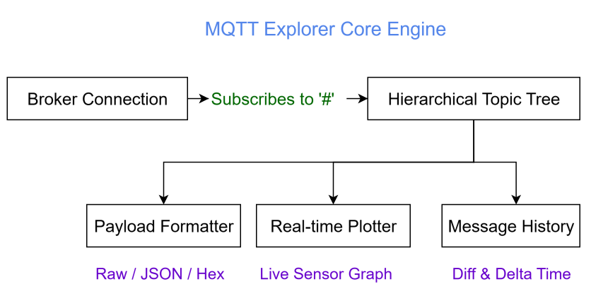
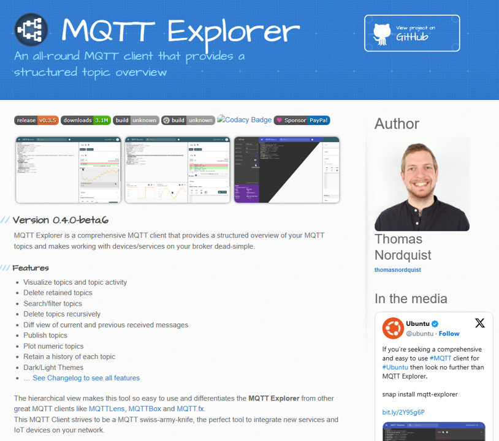
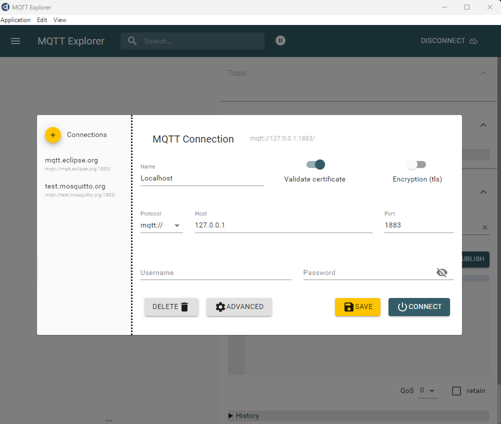
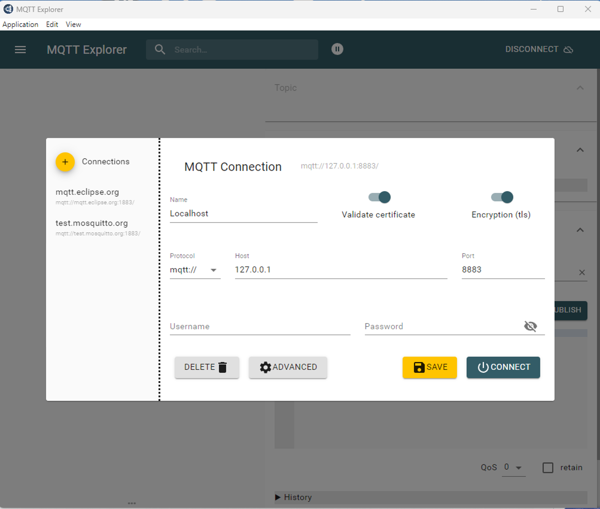
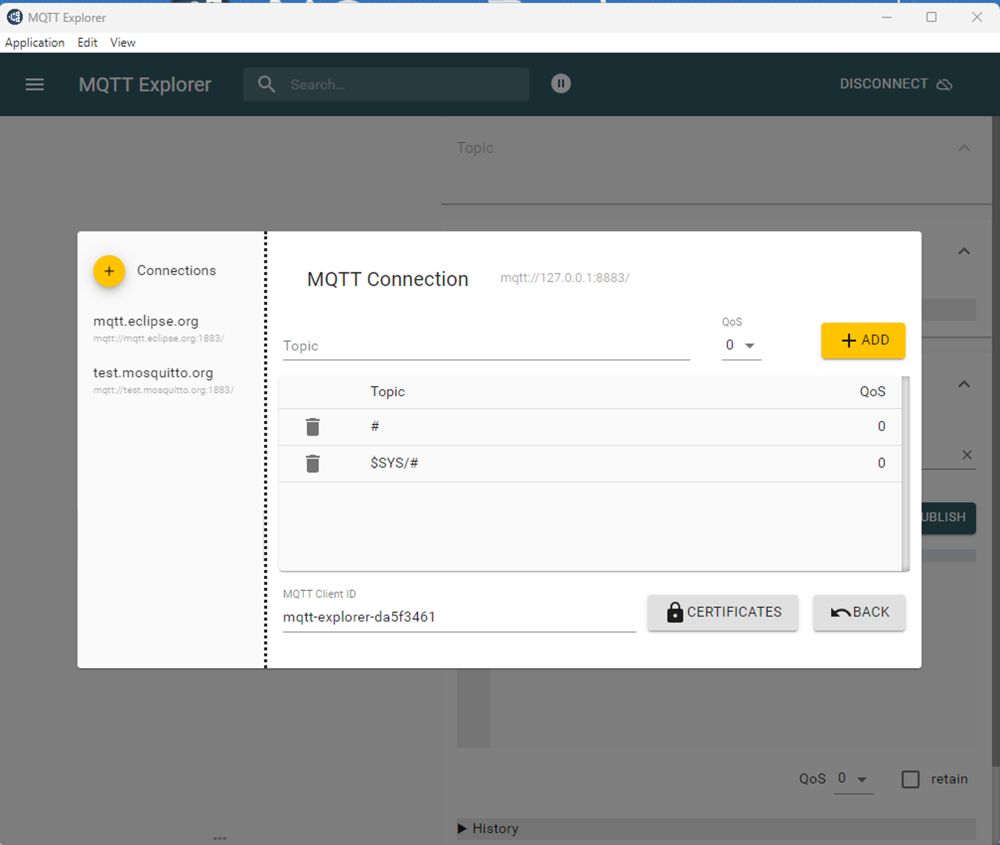
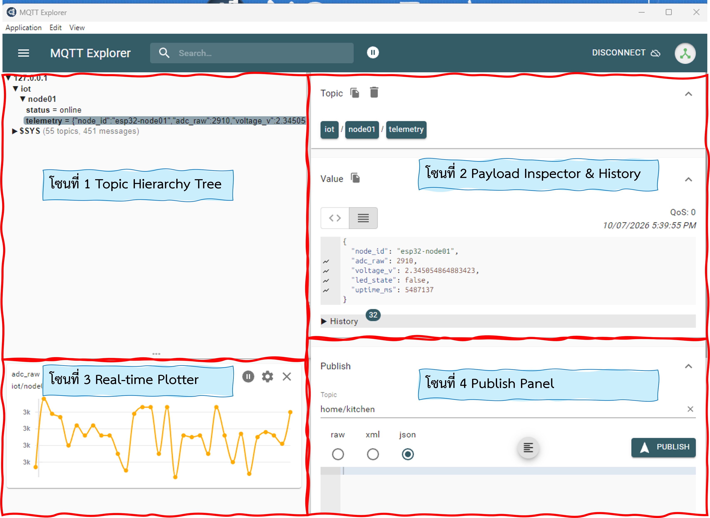
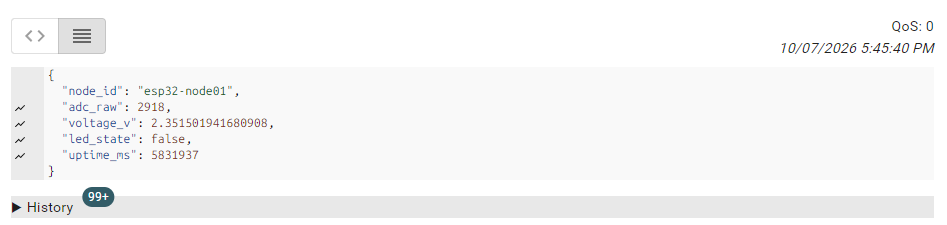
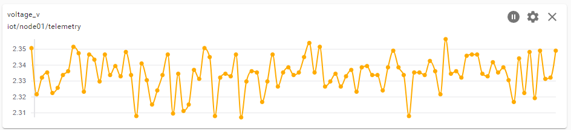
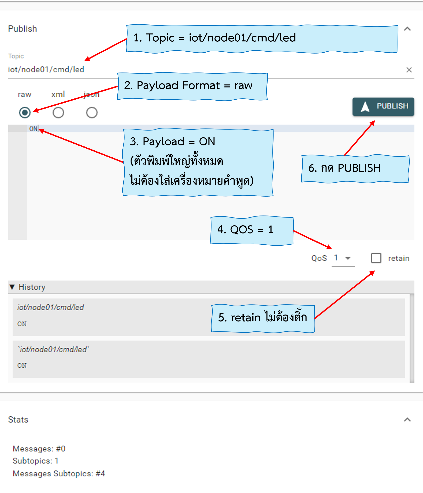
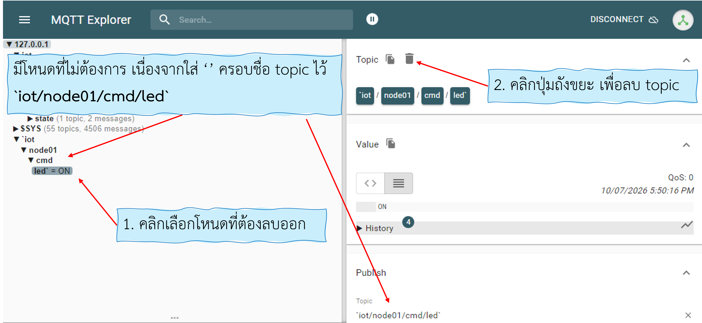

# ภาคผนวกที่ 1 คู่มือการติดตั้งและใช้งานโปรแกรม MQTT Explorer
### (MQTT Explorer Comprehensive Guide for IoT Inspection & Diagnostics)

---

## 1. บทนำ (Introduction)

ในการพัฒนา ทดสอบ และแก้ไขปัญหาระบบโครงข่ายอินเทอร์เน็ตของสรรพสิ่ง (Internet of Things: IoT) ผ่านโปรโตคอล **MQTT (Message Queuing Telemetry Transport)** เครื่องมือประเภทบรรทัดคำสั่ง (Command-Line Interface - CLI) เช่น `mosquitto_sub` และ `mosquitto_pub` มีประโยชน์อย่างยิ่งสำหรับการทดสอบสคริปต์อัตโนมัติหรือการรับส่งข้อความด่วน อย่างไรก็ตาม การใช้ CLI มีข้อจำกัดอย่างมากในการทำงานจริง
* ไม่สามารถมองเห็น **โครงสร้างลำดับชั้นของหัวข้อ (Topic Hierarchy Tree)** ทั้งหมดในระบบพร้อมกันได้
* อ่านข้อมูลที่มีรูปแบบซับซ้อน เช่น **JSON Payload** ได้ยากเมื่อมีข้อมูลหลั่งไหลเข้ามาอย่างต่อเนื่อง
* ไม่สามารถแสดงผลแนวโน้มของค่าตัวเลข (เช่น ค่าเซนเซอร์อุณหภูมิ หรือระดับแรงดันไฟฟ้า) ออกมาเป็นกราฟได้ทันที
* ยุ่งยากในการตรวจสอบและจัดการข้อความที่ค้างอยู่ในระบบ (**Retained Messages**)

**MQTT Explorer** (พัฒนาโดย Thomas Nordquist) เป็นโปรแกรมประเภทโอเพนซอร์ส (Open-Source Desktop Client) ที่ได้รับการยกย่องจากนักพัฒนาและวิศวกร IoT ทั่วโลกว่าเป็น **"เครื่องมือตรวจสอบและดีบัก MQTT ที่ครบเครื่องและทรงพลังที่สุด"** โดยโปรแกรมถูกออกแบบมาเพื่อแก้ปัญหาข้างต้นอย่างตรงจุด

<p align="center">

</p>
<p align="center">
<b>รูปที่ A1-1 </b>อินเทอร์เฟซโปรแกรม MQTT Explorer
</p>
### คุณสมบัติเด่นของ MQTT Explorer
1. **Hierarchical Tree View**
   
   จัดกลุ่มหัวข้อทั้งหมดใน Broker ตามเครื่องหมายทับ (`/`) แสดงผลเป็นกิ่งก้านสาขาคล้ายโครงสร้างโฟลเดอร์ในคอมพิวเตอร์ ทำให้เข้าใจสถาปัตยกรรมหัวข้อ (Topic Architecture) ได้ในทันที
2. **Auto-Formatting & JSON Pretty-Print** 
   
   จัดการย่อหน้า ไฮไลต์สีโค้ด และถอดรหัสโครงสร้างข้อมูล JSON, Raw Text, Hexadecimal และตัวเลขโดยอัตโนมัติ
3. **Real-time Trend Plotting** 
   
   แปลงค่าคีย์ตัวเลขใน JSON Payload เป็นกราฟิกเส้นแนวโน้ม (Time-Series Chart) แบบเรียลไทม์ได้ทันทีโดยไม่ต้องพึ่งพาซอฟต์แวร์แดชบอร์ดภายนอก
4. **Retained Message Management** 
   
   ตรวจสอบหัวข้อที่มีการบันทึกสถานะคงค้าง และมีปุ่มลบ (Purge Topic) เพื่อเคลียร์ข้อความขยะออกจาก Broker ได้ในคลิกเดียว
5. **Interactive Publish Console** 
   
   แผงควบคุมการส่งข้อความทดสอบที่รองรับการกำหนดระดับ QoS (0, 1, 2) และเปิด-ปิดแฟล็ก Retain ได้อย่างยืดหยุ่น

---

## 2. การดาวน์โหลดและติดตั้ง (Download & Installation)

โปรแกรม MQTT Explorer รองรับการทำงานข้ามแพลตฟอร์ม (Cross-Platform) ทั้งบน Windows, macOS และ Linux

### 2.1 ช่องทางการดาวน์โหลด
* **เว็บไซต์ทางการ** [https://mqtt-explorer.com/](https://mqtt-explorer.com/)
* **คลังซอร์สโค้ด (GitHub)** [https://github.com/thomasnordquist/MQTT-Explorer](https://github.com/thomasnordquist/MQTT-Explorer)

### 2.2 ขั้นตอนการติดตั้งบนแต่ละระบบปฏิบัติการ
1. **ระบบปฏิบัติการ Windows**
   * แนะนำให้ดาวน์โหลดไฟล์ติดตั้งนามสกุล `.exe` (Installer) จากเว็บไซต์ทางการ หรือเลือกดาวน์โหลดเวอร์ชัน **Portable** (สามารถแตกไฟล์และรันโปรแกรมได้ทันทีโดยไม่ต้องขอสิทธิ์ Administrator)
   * ดับเบิลคลิกไฟล์ติดตั้ง จากนั้นทำตามคำแนะนำบนหน้าจอจนเสร็จสิ้น
1. **ระบบปฏิบัติการ macOS**
   * สามารถติดตั้งได้โดยตรงผ่าน **Mac App Store** หรือดาวน์โหลดไฟล์ `.dmg` มาลากลงโฟลเดอร์ Applications
1. **ระบบปฏิบัติการ Linux**
   * ดาวน์โหลดไฟล์ในรูปแบบ **AppImage** จากนั้นกำหนดสิทธิ์การรัน (`chmod +x MQTT-Explorer-*.AppImage`) หรือติดตั้งผ่าน Snap Package ด้วยคำสั่ง
     ```bash
     sudo snap install mqtt-explorer
     ```

<p align="center">
<!-- รูปภาพที่ A1-1: หน้าต่างดาวน์โหลดโปรแกรม MQTT Explorer -->

</p>
<p align="center"><b>รูปที่ A1-2</b> หน้าต่างดาวน์โหลดโปรแกรม MQTT Explorer จากเว็บไซต์ทางการ</p>

---

## 3. การสร้างและกำหนดค่าการเชื่อมต่อ (Connection Setup)

เมื่อเปิดโปรแกรม MQTT Explorer ขึ้นมา โปรแกรมจะเริ่มต้นที่หน้าจอ **Connections** ซึ่งเป็นศูนย์รวมโปรไฟล์การเชื่อมต่อไปยัง MQTT Broker ต่างๆ

<p align="center">
<!-- รูปภาพที่ A1-2: หน้าต่างกำหนดค่า Connection Settings -->

</p>
<p align="center"><b>รูปที่ A1-3</b> หน้าต่างกำหนดค่าการเชื่อมต่อเข้าสู่ MQTT Broker</p>

### 3.1 การกำหนดค่าการเชื่อมต่อพื้นฐาน (Standard Plaintext - Port 1883)
สำหรับการทดสอบร่วมกับ Mosquitto Broker ในเครือข่ายท้องถิ่นหรือบนเครื่องตัวเอง ให้ดำเนินการดังนี้
1. กดปุ่ม **`+ Add connection`** เพื่อสร้างโปรไฟล์ใหม่
2. กรอกรายละเอียดในฟิลด์ต่างๆ
   * **Name** ตั้งชื่อโปรไฟล์ที่สื่อความหมาย เช่น `Local Mosquitto` หรือ `ESP32 Lab Broker`
   * **Protocol** เลือกเป็น `mqtt://` (การเชื่อมต่อแบบ Plaintext ไม่เข้ารหัส)
   * **Host**
     * หากรัน Mosquitto บนคอมพิวเตอร์เครื่องเดียวกัน ระบุ `127.0.0.1` หรือ `localhost`
     * หากต้องการเชื่อมต่อระหว่างคอมพิวเตอร์กับบอร์ด ESP32 ในวงแลน **แนะนำให้ระบุหมายเลข IP ประจำเครื่องคอมพิวเตอร์** เช่น `192.168.1.111` เพื่อป้องกันปัญหาการต่อคนละ Interface
   * **Port** กำหนดเป็น `1883` (พอร์ตมาตรฐานของ MQTT)
   * **Username / Password** หากตั้งค่าไฟล์คอนฟิกของ Mosquitto เป็น `allow_anonymous true` ให้เว้นว่างไว้ ไม่ต้องกรอก
1. กดปุ่ม **`SAVE`** เพื่อบันทึกการตั้งค่า
2. กดปุ่ม **`CONNECT`** เพื่อเริ่มต้นการเชื่อมต่อ

---

### 3.2 การกำหนดค่าการเชื่อมต่อความปลอดภัยสูงผ่าน TLS (MQTTS - Port 8883)
สำหรับการเชื่อมต่อตามเนื้อหาใน **ใบงานที่ 11.3 (MQTTS Security with TLS & mTLS)**

<p align="center">
<!-- รูปภาพที่ A1-3: การกำหนดค่า TLS / MQTTS และการแนบ Certificates -->

</p>
<p align="center"><b>รูปที่ A1-4</b> การเปิดใช้งาน TLS และการนำเข้าใบรับรองดิจิทัลสำหรับ MQTTS</p>

1. เปลี่ยน **Protocol** เป็น `mqtts://`
2. กำหนด **Port** เป็น `8883`
3. เลื่อนลงมาที่ส่วน **Advanced** แล้วคลิกเลือกแท็บ **TLS** หรือคลิกที่สวิตช์ **`Validate certificate`**
4. หากใช้งาน Self-Signed Certificate (ใบรับรองที่สร้างขึ้นเอง)
   * **Certificate authority (CA)** คลิกปุ่ม Select file แล้วเลือกไฟล์ `ca.crt`
   * **Client certificate** เลือกไฟล์ `client.crt` (หาก Broker กำหนดให้ทำ Client Authentication / mTLS)
   * **Client key** เลือกไฟล์ `client.key`

---

### 3.3 การตั้งค่าขั้นสูง (Advanced Settings & Topics Filtering)
หากคลิกที่ปุ่ม **`ADVANCED`** ที่มุมขวาล่างของหน้าต่าง Connection

<p align="center">
<!-- รูปภาพที่ A1-4: หน้าต่าง Advanced Settings สำหรับกำหนด Topics Filter -->

</p>
<p align="center"><b>รูปที่ A1-5</b> หน้าต่าง Advanced Settings สำหรับปรับแต่งการ Subscribe หัวข้อ</p>

* **Topic Subscriptions**
  * ค่าตั้งต้นของโปรแกรมจะ Subscribe หัวข้อ `#` (รับทุกหัวข้อในระบบ) และ `$SYS/#` (รับข้อมูลสถิติและสถานะการทำงานภายในของ Broker)
  * > [!TIP]
    > **ข้อแนะนำเชิงประสิทธิภาพ** หากเชื่อมต่อกับ Broker ขนาดใหญ่ในระดับโปรดักชันที่มีทราฟฟิกหนาแน่น แนะนำให้ลบ `$SYS/#` ออก และเปลี่ยน `#` เป็นเฉพาะหัวข้อของโครงการ เช่น `iot/#` เพื่อป้องกันไม่ให้คอมพิวเตอร์ทำงานหนักเกินไป

---

## 4. แผนผังและส่วนประกอบหน้าจอหลัก (Main Interface Anatomy)

เมื่อกดเชื่อมต่อสำเร็จ หน้าจอการทำงานหลักจะปรากฏขึ้น ซึ่งประกอบไปด้วย 4 โซนสำคัญ

<p align="center">
<!-- รูปภาพที่ A1-5: แผนผังภาพรวมหน้าจอหลักของ MQTT Explorer -->

</p>
<p align="center"><b>รูปที่ A1-6</b> ภาพรวมหน้าจอหลักและการแบ่งโซนการทำงานของ MQTT Explorer</p>
### หน้าที่ของแต่ละโซน

|  โซน  | ชื่อส่วนประกอบ                                 | รายละเอียดและหน้าที่สำคัญ                                                                                                     |
| :---: | :--------------------------------------------- | :---------------------------------------------------------------------------------------------------------------------------- |
| **1** | **Topic Hierarchy Tree** (แถบด้านซ้าย)         | แสดงผังหัวข้อทั้งหมดแบบไดนามิก แตกแขนงตาม `/` พร้อมตัวเลขอัตราการส่ง (msg/s) และสัญลักษณ์แสดงข้อความ Retained                 |
| **2** | **Payload Inspector & History** (แถบด้านขวาบน) | เครื่องมือถอดรหัสและแสดงผลเนื้อหาแพ็กเก็ตล่าสุด สามารถเลือกดูแบบ Raw Text, สลับเป็น JSON เพื่อดูโครงสร้างต้นไม้ หรือดูค่า Hex |
| **3** | **Real-time Trend Plotter** (กราฟิกแสดงผล)     | พล็อตกราฟเส้นแนวโน้มของฟิลด์ตัวเลขที่อยู่ใน JSON Payload โดยอัตโนมัติ ช่วยให้วิเคราะห์ค่าเซนเซอร์ได้อย่างชัดเจน               |
| **4** | **Publish Panel** (แถบด้านล่างสุด)             | แผงควบคุมการส่งข้อความ Publish ไปยัง Topic ใดๆ พร้อมตั้งค่าระดับ QoS (0, 1, 2) และ Retain Flag ได้อย่างสะดวกรวดเร็ว           |

---

## 5. ขั้นตอนการใช้งานจริงร่วมกับใบงาน IoT (Step-by-Step Hands-on Tutorials)

เนื้อหาส่วนนี้เป็นการสาธิตการใช้งาน MQTT Explorer ร่วมกับบอร์ด **ESP32** ใน **ใบงานที่ 11.2 (ESP32 MQTT Client Telemetry & Control)**

### 5.1 กรณีศึกษาที่ 1 การตรวจสอบข้อมูลเซนเซอร์สด (Live Telemetry Inspection)
เมื่อบอร์ด ESP32 เริ่มส่งข้อมูล Telemetry เข้ามายัง Broker
1. ในแถบด้านซ้าย (Topic Tree) คลิกคลี่กิ่งหัวข้อ  
   `iot` $\rightarrow$ `node01` $\rightarrow$ `telemetry`
2. สังเกตที่หน้าต่าง Payload ด้านขวาบน
   * คลิกเลือกแท็บ **`JSON`**
   * โปรแกรมจะจัดฟอร์แมต JSON ให้อ่านง่าย (Pretty Print) พร้อมแสดงชนิดตัวแปร 
     ```json
     {
       "node_id": "esp32-node01",
       "adc_raw": 1845,
       "voltage_v": 1.486,
       "led_state": false,
       "uptime_ms": 45120
     }
     ```
1. สังเกตแถบข้อมูลเพิ่มเติม
   * **Timestamp** แสดงเวลาล่าสุดที่ได้รับข้อความ
   * **Message Size** ขนาดของ Payload ในหน่วยไบต์
   * **QoS** ระดับคุณภาพของข้อความที่ได้รับ


<p align="center">
<!-- รูปภาพที่ A1-6: การแสดงผล JSON Telemetry ของ ESP32 -->

</p>
<p align="center"><b>รูปที่ A1-6</b> การถอดรหัสและแสดงผล JSON Telemetry จากบอร์ด ESP32</p>

---

### 5.2 กรณีศึกษาที่ 2 การพล็อตกราฟแรงดันและค่า ADC แบบเรียลไทม์ (Live Sensor Plotting)
หากใน Payload มีข้อมูลที่เป็นตัวเลข (Numeric Value) โปรแกรม MQTT Explorer จะสร้างกราฟแนวโน้มให้ทันที
1. คลิกเลือกหัวข้อ `iot/node01/telemetry`
2. เลื่อนสายตาลงมาที่ส่วนของกรอบกราฟ (ใต้ช่อง JSON Viewer)
3. ติ๊กเครื่องหมายถูกที่คีย์ที่ต้องการแสดงผล เช่น `voltage_v` หรือ `adc_raw`
4. **ทดลองบนฮาร์ดแวร์**  
   ทดลองใช้มือหมุนตัวต้านทานปรับค่าได้ (Potentiometer) บนบอร์ด ESP32 ไปทางซ้ายและขวา
5. **สังเกตผลบนหน้าจอ** เส้นกราฟจะตอบสนองต่อการหมุนของตัวต้านทานทันที โดยจะวาดเป็นเส้นโค้งขึ้น-ลงตามระดับแรงดันที่เปลี่ยนแปลงแบบเรียลไทม์


<p align="center">
<!-- รูปภาพที่ A1-7: การพล็อตกราฟค่า Voltage และ ADC แบบเรียลไทม์ -->

</p>
<p align="center"><b>รูปที่ A1-7</b> กราฟแสดงแนวโน้มของระดับแรงดันไฟฟ้า (voltage_v) แบบเรียลไทม์</p>

---

### 5.3 กรณีศึกษาที่ 3 การส่งคำสั่งควบคุมเปิด-ปิดหลอดไฟ LED (Publishing Control Commands)
การทดสอบส่งคำสั่งจากคอมพิวเตอร์ไปยังบอร์ด ESP32 โดยตรงผ่านแผงควบคุม Publish

1. เลื่อนลงมาที่แถบ **Publish** ด้านล่างสุดของโปรแกรม
2. กำหนดรายละเอียดคำสั่ง
   * **Topic** `iot/node01/cmd/led`
   * **Payload Format** เลือกเป็น `raw`
   * **ข้อความในกล่อง Payload** พิมพ์ `ON` (ตัวพิมพ์ใหญ่ทั้งหมด)
   * **QoS** เลือกเป็น `1` (การันตีว่าคำสั่งส่งถึงอย่างน้อย 1 ครั้ง)
   * **retain** ไม่ต้องติ๊ก (เว้นว่างไว้)
1. กดปุ่ม **`Publish`**
   * **ผลลัพธ์บนฮาร์ดแวร์** หลอดไฟ LED บนบอร์ด ESP32 จะสว่างขึ้นทันที
   * **ผลลัพธ์บนหน้าจอ** ที่หัวข้อ `iot/node01/telemetry` ค่า `"led_state"` จะเปลี่ยนสถานะจาก `false` เป็น `true` ในรอบการส่งถัดไป
1. เมื่อต้องการสั่งปิดไฟ
   * เปลี่ยนข้อความในช่อง Payload เป็น `OFF`
   * กดปุ่ม **`Publish`**
   * หลอดไฟ LED บนบอร์ด ESP32 จะดับลงทันที

<p align="center">
<!-- รูปภาพที่ A1-8: การส่งคำสั่ง Publish เปิด-ปิดหลอดไฟ LED -->

</p>
<p align="center"><b>รูปที่ A1-8</b> การตั้งค่าและการส่งคำสั่งควบคุม LED ผ่าน Publish Panel</p>

---

### 5.4 กรณีศึกษาที่ 4 การส่งคำสั่งควบคุมในรูปแบบ JSON Object
ในระบบ IoT ระดับอุตสาหกรรม มักนิยมส่งคำสั่งควบคุมที่ซับซ้อนในรูปแบบ JSON เช่น กำหนดทั้งสถานะและระดับความสว่าง
1. ในช่อง **Topic** ระบุ `iot/node01/cmd/config`
2. ในช่องฟอร์แมต เลือกเปลี่ยนจาก `raw` เป็น **`json`**
3. พิมพ์เนื้อหา JSON
   ```json
   {
     "state": true,
     "brightness": 75,
     "mode": "AUTO"
   }
   ```
4. กดปุ่ม **`Publish`**  
   โปรแกรมจะตรวจสอบความถูกต้องของไวยากรณ์ JSON ก่อนส่งออกไปยัง Broker

---

### 5.5 กรณีศึกษาที่ 5 การจัดการและล้างข้อความคงค้าง (Deleting Retained Messages)
เมื่อมีการส่งข้อความโดยเปิดแฟล็ก Retain (`-r`) ไว้ ข้อมูลนั้นจะถูกเก็บไว้ในหน่วยความจำของ Broker ตลอดไป แม้ว่าอุปกรณ์จะปิดไปแล้วก็ตาม ซึ่งอาจก่อให้เกิดข้อมูลขยะตกค้าง

1. คลิกเลือกหัวข้อที่ต้องการลบในแถบ Topic Tree (เช่น มีหัวข้อทดสอบที่ไม่ใช้งานแล้ว)
2. สังเกตที่มุมขวาบนของหน้าต่างรายละเอียดหัวข้อ จะมีไอคอนรูป **ถังขยะ (Delete Topic)**
3. คลิกที่ไอคอนถังขยะ
   * โปรแกรม MQTT Explorer จะส่งแพ็กเก็ต Publish ที่มี **Zero-byte Payload (Empty Payload)** ร่วมกับแฟล็ก **Retain = true** ไปยัง Broker โดยอัตโนมัติ
   * Broker จะลบหัวข้อนั้นออกจากหน่วยความจำทันที และหัวข้อย่อยนั้นจะหายไปจาก Topic Tree บนหน้าจอ

<p align="center">
<!-- รูปภาพที่ A1-9: การกดปุ่มรูปถังขยะเพื่อลบ Retained Topic -->

</p>
<p align="center"><b>รูปที่ A1-9</b> การลบหัวข้อคงค้าง (Retained Message) ด้วยไอคอนรูปถังขยะ</p>

---

## 6. เกร็ดเชิงเทคนิคและข้อควรระวัง (Technical Tips & Gotchas)

### ข้อสงสัยที่ 1 ทำไมคำสั่งที่ Publish ด้วย QoS 1 หรือ 2 จึงแสดงผลเป็น `QoS 0` ใน MQTT Explorer?
> [!NOTE]
> **คำอธิบายทางวิศวกรรม**  
> ตามข้อกำหนดมาตรฐานของ **MQTT Specification (OASIS Standard)** ระดับคุณภาพของข้อความที่ส่งถึงผู้รับจริง (Delivered QoS) จะถูกจำกัดด้วยระดับคุณภาพที่ผู้รับได้ทำการบอกรับไว้ ตามสมการ
> 
> $$\text{Delivered QoS} = \min(\text{QoS}_{\text{publish}}, \text{QoS}_{\text{subscribe}})$$
> 
> โปรแกรม MQTT Explorer ถูกออกแบบมาเพื่อทำหน้าที่เป็นมอนิเตอร์ส่วนกลาง จึงทำการบอกรับทุกหัวข้อ (`#`) ด้วย **QoS 0** เป็นค่าเริ่มต้น เพื่อหลีกเลี่ยงภาระการแลกเปลี่ยนแพ็กเก็ต ACK (เช่น PUBACK หรือ PUBREC) มหาศาลกับ Broker  
> ดังนั้น เมื่อ Publisher (เช่น CLI หรือ ESP32) ส่งข้อความเข้ามาด้วย QoS 1 แต่ MQTT Explorer บอกรับไว้ด้วย QoS 0 ตัว Broker จึงทำการลดทอนระดับ (Downgrade) ข้อความลงเป็น QoS 0 ก่อนส่งให้ MQTT Explorer ซึ่งเป็นพฤติกรรมที่ถูกต้องตามมาตรฐานสากล

---

### ข้อสงสัยที่ 2 สั่ง `mosquitto_pub` จากเทอร์มินัลแล้ว แต่ใน MQTT Explorer ไม่ปรากฏข้อความ?
สาเหตุส่วนใหญ่เกิดจาก 2 ปัจจัยหลัก
1. **ข้อความไม่ได้เปิด Retain (`-r`)**  
   หากสั่ง Publish ข้อความแบบธรรมดา ในขณะที่ MQTT Explorer ยังไม่ได้กด Connect หรือกดเชื่อมต่อไม่ทัน ข้อความจะส่งผ่าน Broker ไปยังผู้รับอื่นแล้วสูญหายทันที จะไม่มีข้อความค้างไว้ให้ Explorer เห็น
2. **ปัญหาโบรกเกอร์ซ้ำซ้อนบน Windows (Split-Brain Broker)**  
   บน Windows เมื่อติดตั้ง Mosquitto ระบบจะสร้าง **Windows Service** ขึ้นมาทำงานเบื้องหลังโดยอัตโนมัติ (เกาะพอร์ต `127.0.0.1:1883`) ในขณะเดียวกัน เมื่อผู้ใช้พิมพ์คำสั่ง `mosquitto -c mosquitto.conf -v` บน PowerShell เพื่อให้รับไอพีภายนอก ระบบจะไปรันอีก Process หนึ่ง (เกาะพอร์ต `0.0.0.0:1883` หรือ IP วงแลน)
   * หาก MQTT Explorer เชื่อมต่อไปที่ `127.0.0.1` แต่บอร์ด ESP32 เชื่อมต่อไปที่ `192.168.1.111` ทั้งสองอุปกรณ์จะอยู่บนคนละ Broker ทำให้มองไม่เห็นข้อมูลของกันและกัน
   * **วิธีแก้ไข** ใน MQTT Explorer ให้กรอกช่อง Host เป็นหมายเลข IP ของวงแลนเสมอ (เช่น `192.168.1.111`) หรือทำการปิด Windows Service ก่อนทดสอบ
     ```powershell
     Stop-Service mosquitto
     Set-Service mosquitto -StartupType Manual
     ```

---

### ข้อสงสัยที่ 3 เกิดข้อผิดพลาด Connection Refused หรือ Timed Out
หากกดเชื่อมต่อแล้วไม่สามารถเข้าสู่ Broker ได้
* **Connection Refused** เกิดจาก Mosquitto ไม่ได้เปิดทำงานอยู่ หรือไฟล์คอนฟิกไม่อนุญาตการเชื่อมต่อแบบ Anonymous (ตรวจสอบว่ามีคำสั่ง `allow_anonymous true` และ `listener 1883 0.0.0.0` หรือไม่)
* **Connection Timed Out** เกิดจากระบบความปลอดภัย **Windows Defender Firewall** บล็อกพอร์ต 1883 ไม่ให้โปรแกรมภายนอกเข้าถึง ให้ตรวจสอบกฎ Inbound Rules ใน Firewall

---

## 7. รายการตรวจสอบก่อนการทดสอบ (Developer Checklist)

เพื่อความราบรื่นในการทำปฏิบัติการและการทดสอบระบบ IoT แนะนำให้ตรวจสอบรายการต่อไปนี้

* [ ] ตรวจสอบว่าโปรแกรม Mosquitto Broker กำลังทำงานอยู่ (มีหน้าต่างรันคำสั่งพร้อมแสดง Log การเชื่อมต่อ)
* [ ] ทราบหมายเลข IP แอดเดรสของเครื่องคอมพิวเตอร์ในวงแลนอย่างแม่นยำ (คำสั่ง `ipconfig`)
* [ ] ใน MQTT Explorer กำหนด Host เป็น IP ของเครื่องคอมพิวเตอร์ และพอร์ตเป็น `1883`
* [ ] บอร์ด ESP32 เชื่อมต่อกับ Wi-Fi วงเดียวกันกับคอมพิวเตอร์เรียบร้อยแล้ว
* [ ] ใน Topic Tree แตกกิ่งหัวข้อ `iot/node01/telemetry` เพื่อดู JSON Payload
* [ ] ทดสอบเปิด-ปิดหลอดไฟผ่าน Publish Panel ด้วยหัวข้อ `iot/node01/cmd/led` และสังเกตการตอบสนองของฮาร์ดแวร์

---

## 8. สรุปภาพรวม (Summary)

**MQTT Explorer** เปรียบเสมือนเครื่องมือ **Oscilloscope ประจำระบบเครือข่าย IoT** ที่ช่วยให้นักพัฒนาสามารถมองเห็นการไหลเวียนของข้อมูล ตรวจสอบสถานะของโหนดอุปกรณ์ ตรวจจับข้อผิดพลาดของข้อมูล JSON และทดสอบการสั่งการได้อย่างแม่นยำ การฝึกใช้งาน MQTT Explorer ให้ชำนาญจะช่วยประหยัดเวลาในการแก้ปัญหา (Debugging) และยกระดับการพัฒนาระบบ IoT สู่ความเป็นมืออาชีพได้อย่างมีประสิทธิภาพ