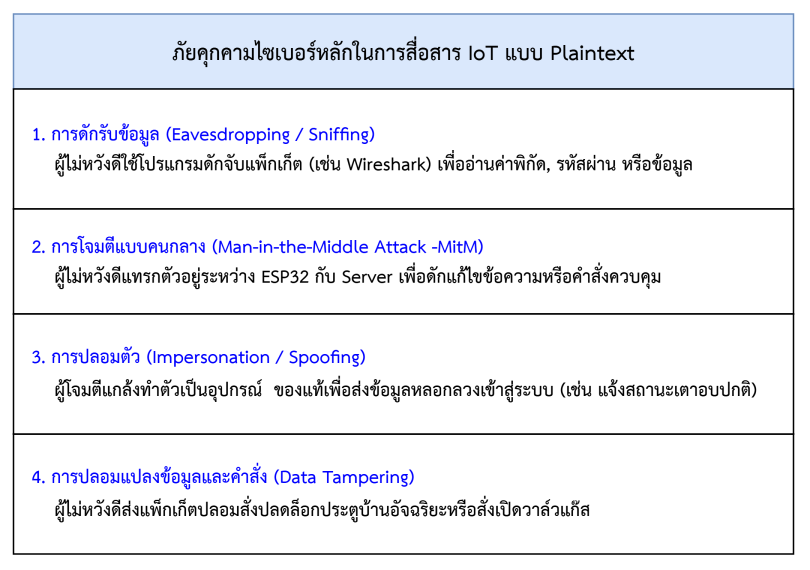
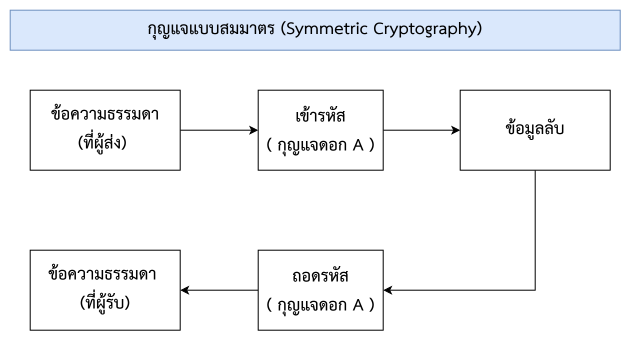
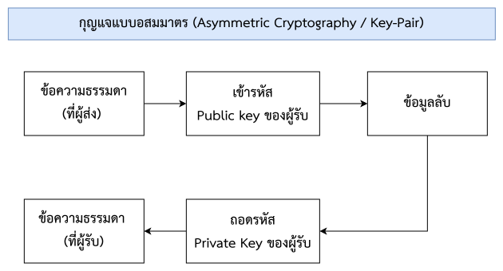
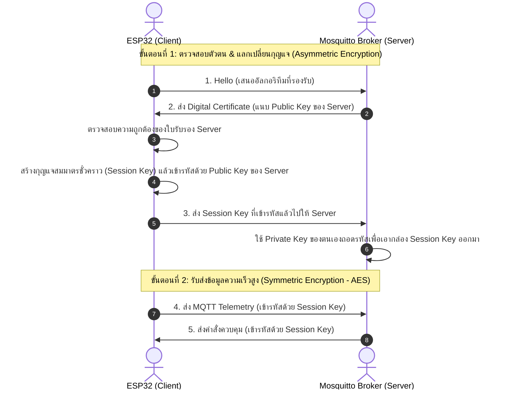
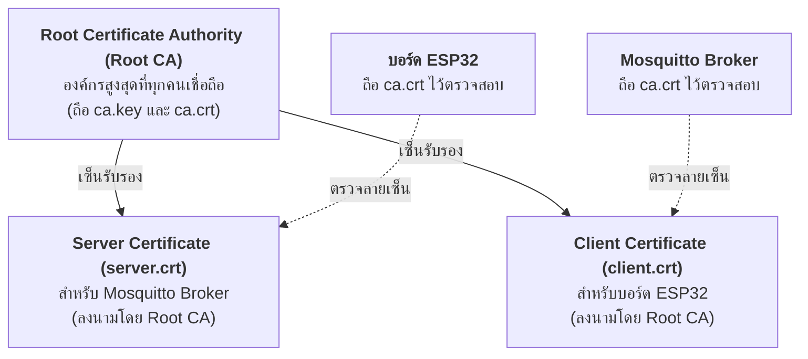

# ภาคผนวกที่ 2 พื้นฐานความปลอดภัยไซเบอร์, กลไกคู่กุญแจ (Key-Pairs) และการใช้งาน OpenSSL สำหรับ IoT
### (Cybersecurity Fundamentals, Asymmetric Cryptography & OpenSSL Practical Guide for IoT Engineers)

---

## 1. ทำไมระบบ IoT ถึงต้องการความปลอดภัยทางไซเบอร์? 

ในบทเรียนที่ผ่านมา การส่งข้อมูลเซนเซอร์และการควบคุมผ่านโปรโตคอล HTTP REST (พอร์ต 80) หรือ MQTT ธรรมดา (พอร์ต 1883) เป็นการสื่อสารแบบ **ข้อมูลธรรมดาไม่เข้ารหัส (Plaintext)** ซึ่งข้อมูลทุกตัวอักษรวิ่งผ่านสายสัญญาณและคลื่นวิทยุ Wi-Fi ในรูปแบบที่ใครก็ตามที่อยู่ในเครือข่ายสามารถดักอ่านได้

ในบริบทของโครงข่ายบริเวณกว้าง (WAN) หรือการควบคุมผ่านคลาวด์ ข้อความจะเดินทางผ่านเราเตอร์ภายนอกหลายสิบจุด หากไม่มีระบบความปลอดภัย อุปกรณ์ IoT ของเราจะตกเป็นเป้าหมายของการโจมตีได้โดยง่าย:

<p align = "center">

</p>

### 1.1 สามเหลี่ยมความมั่นคงปลอดภัย (The CIA Triad) ในงาน IoT
เพื่อป้องกันภัยคุกคามดังกล่าว วิศวกรจำเป็นต้องสร้างระบบความปลอดภัยที่ตอบโจทย์ 3 เสาหลัก
1. **การรักษาความลับ (Confidentiality)**  ข้อมูลต้องถูกเข้ารหัส ผู้ที่ไม่มีสิทธิ์ไม่สามารถอ่านออกได้
2. **ความถูกต้องสมบูรณ์ (Integrity)**  ข้อมูลต้องไม่ถูกดัดแปลงระหว่างการส่ง หากมีการแก้ไขแม้แต่ 1 บิต ปลายทางต้องตรวจพบได้ทันที
3. **ความพร้อมใช้งาน (Availability)**  ระบบต้องพร้อมให้บริการ ไม่ถูกโจมตีจนหยุดชะงัก (เช่น DoS Attack)
4. **การยืนยันตัวตน (Authentication)**  ต้องพิสูจน์ได้ว่าผู้ส่งและผู้รับเป็นตัวจริง ไม่ใช่เครื่องปลอม

---

## 2. หลักการเข้ารหัสลับ กุญแจสมมาตร vs กุญแจอสมมาตร (Symmetric vs Asymmetric Cryptography)

ในการรักษาความปลอดภัยของข้อมูล เราต้องใช้คณิตศาสตร์เข้ามาเปลี่ยนข้อมูลปกติ (Plaintext) ให้กลายเป็นรหัสที่อ่านไม่ออก (Ciphertext) โดยมี 2 รูปแบบหลัก


<p align = "center">

</p>

<p align = "center">
<b>ภาพที่ 2.1</b> การทำงานของการเข้ารหัสแบบสมมาตร (Symmetric Encryption)
</p>


<p align = "center">

</p>

<p align = "center">
<b>ภาพที่ 2.2</b> การทำงานของการเข้ารหัสแบบอสมมาตร (Asymmetric Encryption / Key-pair)
</p>


### 2.1 การเข้ารหัสแบบสมมาตร (Symmetric Encryption)
* ใช้ **"กุญแจดอกเดียวกัน"** ทั้งในการเข้ารหัสและถอดรหัส (เช่น อัลกอริทึม **AES-128**, **AES-256**)
* **ข้อดี** ประมวลผลได้เร็วมาก ใช้พลังงานซีพียูและหน่วยความจำน้อยมาก เหมาะสำหรับส่งข้อมูลปริมาณมาก
* **ข้อจำกัด (ปัญหาคอขวด)**  **"การแจกจ่ายกุญแจ (Key Distribution Problem)"** กล่าวคือ บอร์ด ESP32 ที่อยู่กรุงเทพ จะส่งกุญแจดอกนี้ไปให้ Cloud Server ที่สิงคโปร์ได้อย่างไรโดยไม่ให้แฮกเกอร์ที่อยู่ระหว่างทางดักจับได้

---

### 2.2 การเข้ารหัสแบบอสมมาตรและหลักการคู่กุญแจ (Asymmetric Cryptography & Key-Pairs)
เพื่อแก้ปัญหาการแจกจ่ายกุญแจ นักวิทยาการรหัสลับจึงคิดค้นระบบ **กุญแจคู่ (Key-Pair)** ขึ้นมา โดย 1 คู่จะประกอบด้วยกุญแจ 2 ดอกที่มีความสัมพันธ์ทางคณิตศาสตร์อย่างแยกไม่ออก:

```
       +-------------------------------------------------------------+
       |                     คู่กุญแจ (Key-Pair)                      |
       +------------------------------+------------------------------+
                                      |
              +-----------------------+-----------------------+
              |                                               |
              v                                               v
     [ กุญแจส่วนตัว: Private Key ]                     [ กุญแจสาธารณะ: Public Key ]
     - เป็นความลับสูงสุด ห้ามเปิดเผยเด็ดขาด              - แจกจ่ายให้ใครก็ได้ในโลก (Public)
     - เก็บไว้ในตัวเครื่องของตนเองเท่านั้น               - ใครๆ ก็สามารถนำไปใช้ได้
     - ใช้สำหรับ: "ถอดรหัส" และ "ลงนามดิจิทัล"          - ใช้สำหรับ: "เข้ารหัส" และ "ตรวจสอบลายมือชื่อ"
```

#### หน้าที่ 2 ประการของคู่กุญแจ:
1. **การเข้ารหัสข้อมูลลับ (Data Encryption)**:
   * หากต้องการส่งข้อความลับให้ Server $\rightarrow$ ให้นำ **Public Key ของ Server** มาเข้ารหัส
   * ข้อมูลที่ถูกเข้ารหัสด้วย Public Key นี้ **มีเพียง Private Key ของ Server เท่านั้น** ที่สามารถถอดรหัสได้ แม้แต่ผู้เข้ารหัสเองก็ไม่สามารถถอดรหัสกลับได้!
2. **การลงนามดิจิทัล (Digital Signature)**:
   * หาก Server ต้องการพิสูจน์ว่าเป็นตัวจริง $\rightarrow$ Server จะนำข้อความไปลงนามด้วย **Private Key ของตนเอง**
   * ทุกคนที่ถือ **Public Key ของ Server** จะสามารถตรวจสอบลายมือชื่อได้ว่า เอกสารนี้ถูกสร้างโดยผู้ถือกุญแจส่วนตัวตัวจริง และข้อมูลไม่ถูกดัดแปลง

---

### 2.3 การผสมผสานใน TLS: ระบบเข้ารหัสแบบไฮบริด (Hybrid Encryption in TLS)
ในการใช้งานจริง การคำนวณของกุญแจอสมมาตร (RSA/ECC) ใช้เวลาและพลังงานซีพียูสูงกว่ากุญแจสมมาตรนับร้อยเท่า โปรโตคอล **TLS (Transport Layer Security)** จึงนำจุดเด่นของทั้งสองระบบมาทำงานร่วมกัน:



---

## 3. โครงสร้างพื้นฐานกุญแจสาธารณะ (PKI) และใบรับรองดิจิทัล (Digital Certificates)

### 3.1 ปัญหาของ Public Key โดดๆ (The Identity Problem)
สมมติว่า ESP32 เชื่อมต่อไปยัง Server แล้ว Server ส่ง Public Key ก้อนหนึ่งมาให้... คำถามคือ **"ESP32 จะรู้ได้อย่างไรว่า Public Key นี้เป็นของ Mosquitto Broker ของเราจริงๆ ไม่ใช่ Public Key ของแฮกเกอร์ที่ปลอมตัวมา?"**

ทางออกของปัญหานี้คือ **ใบรับรองดิจิทัล (Digital Certificate มาตรฐาน X.509)**

### 3.2 ใบรับรองดิจิทัล X.509 คืออะไร?
ใบรับรองดิจิทัลเปรียบเสมือน **"บัตรประชาชน"** หรือ **"พาสปอร์ตดิจิทัล"** ที่ออกโดยหน่วยงานที่ทุกคนไว้วางใจ โดยภายในไฟล์ใบรับรองประกอบไปด้วย:
* **Subject**: ข้อมูลเจ้าของใบรับรอง (ชื่อองค์กร, ประเทศ, หมายเลข IP หรือ โดเมนเนม)
* **Public Key**: กุญแจสาธารณะของเจ้าของใบรับรอง
* **Issuer**: องค์กรผู้ออกและรับรองบัตรใบนี้
* **Validity Period**: วันเริ่มต้นและวันหมดอายุของใบรับรอง
* **Digital Signature**: ลายมือชื่อดิจิทัลของผู้ออกบัตร ซึ่งกำกับไว้เพื่อป้องกันการปลอมแปลง

```
+-----------------------------------------------------------------------------------+
|                           โครงสร้างไฟล์ใบรับรองดิจิทัล (X.509)                     |
+-----------------------------------------------------------------------------------+
|  Version           : 3                                                            |
|  Serial Number     : 01:A4:F2:...                                                 |
|  Subject (เจ้าของ)  : CN=192.168.1.111, O=IoT Engineering, C=TH                   |
|  Public Key Info   : RSA (2048 bit) - [ก้อนข้อมูล Public Key]                      |
|  Validity Period   : Not Before: Oct 2026, Not After: Oct 2036                    |
|  Issuer (ผู้ออกบัตร): CN=IoT Root CA, O=IoT Security Lab, C=TH                     |
|  Signature         : [ลายมือชื่อดิจิทัลที่ลงนามโดย Private Key ของ Root CA]          |
+-----------------------------------------------------------------------------------+
```

---

### 3.3 องค์กรรับรองความถูกต้อง (Certificate Authority - CA) และสายสัมพันธ์แห่งความไว้ใจ (Chain of Trust)



1. **Root CA (ผู้รับรองสูงสุด)**: เป็นเสมือน "กระทรวงมหาดไทย" ที่ทำหน้าที่เซ็นออกบัตรประชาชนให้ทุกคน ในห้องปฏิบัติการ เราจะสร้าง **Local Root CA** ขึ้นมาใช้งานเอง
2. **Chain of Trust**: 
   * เมื่อ ESP32 จะเชื่อมต่อกับ Mosquitto Broker ตัว ESP32 จะหยิบไฟล์ `ca.crt` (ของ Root CA) ที่ฝังอยู่ในตัวมันขึ้นมาตรวจลายเซ็นบน `server.crt`
   * ถ้าลายเซ็นถูกต้อง $\rightarrow$ มั่นใจได้ 100% ว่า Broker นี้เป็นตัวจริง ไม่ใช่เครื่องปลอม

---

## 4. ทำความรู้จักกับเครื่องมือ OpenSSL (What is OpenSSL?)

**OpenSSL** เป็นชุดเครื่องมือและไลบรารีมาตรฐานระดับโลกสำหรับการคำนวณด้านวิทยาการรหัสลับและการสื่อสารความปลอดภัยสูงผ่านโปรโตคอล SSL/TLS รองรับทั้งบน Windows, macOS และ Linux

### 4.1 รูปแบบไฟล์ที่พบบ่อยในการทำงานกับ OpenSSL:

| นามสกุลไฟล์ | ชนิดของข้อมูล | คำอธิบายและความสำคัญ | การรักษาความลับ |
| :---: | :--- | :--- | :---: |
| **`.key`** | **Private Key** (กุญแจส่วนตัว) | ไฟล์บรรจุข้อมูลกุญแจลับเฉพาะตัว ห้ามส่งต่อให้ผู้อื่นเด็ดขาด | **ความลับสูงสุด ⚠️** |
| **`.csr`** | **Certificate Signing Request** | ไฟล์คำร้องขอใบรับรอง (ส่ง Public Key + ข้อมูลองค์กรให้ CA เซ็น) ลบทิ้งได้หลังสร้าง `.crt` เสร็จ | ไม่เป็นความลับ |
| **`.crt`** หรือ **`.pem`** | **Certificate** (ใบรับรองดิจิทัล) | ใบรับรอง X.509 ที่ได้รับการลงนามแล้ว พร้อมใช้งานแจกจ่าย | แจกจ่ายสาธารณะได้ |

> [!NOTE]
> **PEM Format คืออะไร?**  
> ไฟล์ `.key`, `.crt`, และ `.pem` ส่วนใหญ่เป็นข้อความรหัสฐาน 64 (Base64 ASCII) ที่ขึ้นต้นด้วย `-----BEGIN CERTIFICATE-----` และลงท้ายด้วย `-----END CERTIFICATE-----` ซึ่งสามารถเปิดดูด้วยโปรแกรม Text Editor (เช่น VS Code, Notepad) ได้โดยตรง

---

## 5. คู่มือคำสั่ง OpenSSL ฉบับวิศวกร IoT (Step-by-Step Command Deep Dive)

ในกิจกรรมของ **ใบงานที่ 11.3** เราได้ใช้ชุดคำสั่ง OpenSSL ในการจัดทำระบบรักษาความปลอดภัย หัวข้อนี้จะชำแหละและอธิบายความหมายของแต่ละพารามิเตอร์อย่างละเอียด:

```
[ ภาพรวมกระบวนการสร้างใบรับรอง 3 ขั้นตอน ]

   ขั้นตอนที่ 1 (Root CA)           ขั้นตอนที่ 2 (Server)             ขั้นตอนที่ 3 (Client)
  +---------------------+        +-----------------------+        +-----------------------+
  |  1. สร้าง ca.key    |        |  1. สร้าง server.key  |        |  1. สร้าง client.key  |
  |  2. สร้าง ca.csr    |        |  2. สร้าง server.csr  |        |  2. สร้าง client.csr  |
  |  3. เซ็นเป็น ca.crt |        |  3. ใช้ CA เซ็นออก    |        |  3. ใช้ CA เซ็นออก    |
  |     (Self-Signed)   |        |     server.crt        |        |     client.crt        |
  +---------------------+        +-----------------------+        +-----------------------+
```

---

### ขั้นตอนที่ 5.1: การสร้างกุญแจและใบรับรอง Root CA (ผู้รับรองสูงสุด)

#### 1. คำสั่งสร้าง Private Key ของ Root CA:
```bash
openssl genrsa -out ca.key 2048
```
* `genrsa`: สั่งให้สร้างคู่กุญแจตามอัลกอริทึม RSA (Rivest–Shamir–Adleman)
* `-out ca.key`: ระบุชื่อไฟล์กุญแจผลลัพธ์ที่จะบันทึก
* `2048`: ความยาวกุญแจขนาด 2048 บิต (เป็นขนาดมาตรฐานที่ปลอดภัยและประมวลผลได้ดีบนไมโครคอนโทรลเลอร์)

#### 2. คำสั่งสร้างคำร้องขอใบรับรอง (CSR) ของ Root CA:
```bash
openssl req -out ca.csr -key ca.key -new -subj "/C=TH/ST=Bangkok/O=IoT Security Lab/CN=IoT Root CA"
```
* `req -new`: ขอสร้างคำร้องขอใบรับรองใหม่
* `-key ca.key`: ดึงข้อมูล Public Key มาจากไฟล์ Private Key `ca.key`
* `-subj`: กำหนดข้อมูลจำเพาะของผู้ถือบัตร (Subject Information):
  * `C=TH`: Country (ประเทศ)
  * `ST=Bangkok`: State/Province (จังหวัด)
  * `O=IoT Security Lab`: Organization (ชื่อองค์กร/หน่วยงาน)
  * `CN=IoT Root CA`: **Common Name** (ชื่อหลักของผู้ออกใบรับรอง)

#### 3. คำสั่งลงนามออกใบรับรอง Root CA (Self-Signed):
```bash
openssl x509 -req -in ca.csr -out ca.crt -sha256 -days 3650 -signkey ca.key
```
* `x509`: สั่งให้ออกใบรับรองดิจิทัลตามมาตรฐาน ITU-T X.509
* `-sha256`: ใช้อัลกอริทึมแฮช Secure Hash Algorithm 256 บิต ในการลงนาม
* `-days 3650`: อายุการใช้งานของใบรับรอง (3650 วัน หรือประมาณ 10 ปี)
* `-signkey ca.key`: เนื่องจาก Root CA เป็นองค์กรสูงสุด จึงใช้กุญแจของตนเองเซ็นรับรองตนเอง (**Self-Signed**)

---

### ขั้นตอนที่ 5.2: การสร้างใบรับรอง Server (สำหรับ Mosquitto Broker)

```bash
# 1. สร้าง Private Key ของ Server
openssl genrsa -out server.key 2048

# 2. สร้าง CSR ของ Server (ระบุ IP ประจำเครื่องคอมพิวเตอร์ในช่อง CN)
openssl req -out server.csr -key server.key -new -subj "/C=TH/ST=Bangkok/O=IoT Broker/CN=192.168.1.111"

# 3. นำ CSR ให้ Root CA ทำการลงนามออกใบรับรอง server.crt
openssl x509 -req -in server.csr -out server.crt -sha256 -CA ca.crt -CAkey ca.key -CAcreateserial -days 3650
```

> [!IMPORTANT]
> **กฎเหล็กของ Common Name (CN) สำหรับ Server:**  
> ในขั้นตอนสร้าง `server.csr` ค่า **CN** จะต้องตรงกับ **Host / IP Address หรือ Domain Name ที่ Client ใช้เชื่อมต่อจริง** (เช่น `192.168.1.111`)  
> หากระบุ CN ไม่ตรง (เช่น ระบุเป็น `MyServer` แต่ ESP32 ต่อเข้า `192.168.1.111`) ตัว ESP32 จะปฏิเสธการเชื่อมต่อทันทีเนื่องจากเกิดข้อผิดพลาด **"Hostname / Common Name Mismatch"**

* `-CA ca.crt`: อ้างอิงใบรับรองของ Root CA ที่เป็นผู้ลงนาม
* `-CAkey ca.key`: ใช้ Private Key ของ Root CA ในการเซ็นชื่อกำกับ
* `-CAcreateserial`: สร้างไฟล์ `.srl` เพื่อเก็บเลขลำดับประจำตัวใบรับรอง (Serial Number) โดยอัตโนมัติ

---

### ขั้นตอนที่ 5.3: การสร้างใบรับรอง Client (สำหรับบอร์ด ESP32)

```bash
# 1. สร้าง Private Key ของ ESP32
openssl genrsa -out client.key 2048

# 2. สร้าง CSR ของ ESP32
openssl req -out client.csr -key client.key -new -subj "/C=TH/ST=Bangkok/O=IoT Node/CN=esp32-node01"

# 3. นำ CSR ให้ Root CA ทำการลงนามออกใบรับรอง client.crt
openssl x509 -req -in client.csr -out client.crt -sha256 -CA ca.crt -CAkey ca.key -CAcreateserial -days 3650
```

---

## 6. คำสั่ง OpenSSL สำหรับการตรวจสอบและแก้ไขปัญหา (Inspection & Diagnostic Commands)

เมื่อสร้างไฟล์ใบรับรองเสร็จสิ้น วิศวกรสามารถใช้คำสั่งเหล่านี้เพื่อตรวจสอบความถูกต้องของข้อมูลก่อนนำไปติดตั้งลงในอุปกรณ์:

### 6.1 คำสั่งอ่านรายละเอียดในไฟล์ใบรับรอง (`.crt`):
```bash
openssl x509 -in server.crt -text -noout
```
* ตรวจสอบดูค่า **Subject Alternative Name (SAN)**, **Common Name (CN)**, วันหมดอายุ (Validity Not After) และผู้ออกใบรับรอง (Issuer)

### 6.2 คำสั่งทดสอบตรวจสอบความถูกต้องของใบรับรองกับ Root CA:
```bash
openssl verify -CAfile ca.crt server.crt
openssl verify -CAfile ca.crt client.crt
```
* หากทุกอย่างถูกต้อง หน้าจอจะตอบกลับว่า: `server.crt: OK`
* หากไม่ผ่าน จะแสดงสาเหตุข้อผิดพลาด เช่น `unable to get local issuer certificate`

### 6.3 คำสั่งตรวจสอบว่าไฟล์ Key และไฟล์ CRT เป็นคู่กุญแจเดียวกันจริงหรือไม่?
บ่อยครั้งที่นักศึกษาสับสนและนำไฟล์ Key ของเครื่องหนึ่งไปใช้กับ CRT ของอีกเครื่องหนึ่ง สามารถทดสอบค่า Hash Modulus ได้ด้วยคำสั่ง:
```bash
openssl x509 -noout -modulus -in server.crt | openssl md5
openssl rsa -noout -modulus -in server.key | openssl md5
```
* **ผลลัพธ์**: ค่ารหัสแฮช MD5 ของทั้งสองคำสั่ง **จะต้องตรงกันทุกหลัก** หากไม่ตรง แสดงว่าหยิบไฟล์ผิดคู่!

---

## 7. ความแตกต่างระหว่าง One-Way TLS และ Mutual TLS (mTLS)

```
[ 1. One-Way TLS (เช่น เว็บเบราว์เซอร์เข้า HTTPS ทั่วไป) ]
  Client (ESP32)  ====== ตรวจสอบใบรับรอง ======>  Server (Broker)
  * ผลลัพธ์: Client มั่นใจว่า Server เป็นตัวจริง แต่ Server ไม่รู้ว่า Client เป็นใคร (ต้องอาศัย Username/Password แทน)

[ 2. Two-Way TLS / Mutual TLS (mTLS - มาตรฐานความปลอดภัย IoT สูงสุด) ]
  Client (ESP32)  ====== ตรวจสอบใบรับรอง ======>  Server (Broker)
  Client (ESP32)  <===== ตรวจสอบใบรับรอง ======  Server (Broker)
  * ผลลัพธ์: ทั้งสองฝ่ายตรวจสอบใบรับรองซึ่งกันและกัน อุปกรณ์ปลอมแปลงจะไม่สามารถส่งหรือรับข้อมูลได้เลยแม้แต่ไบต์เดียว!
```

### ทำไมระบบ IoT อุตสาหกรรมถึงต้องใช้ mTLS?
1. **หมดปัญหาการรั่วไหลของรหัสผ่าน**: ไม่ต้องเก็บรหัสผ่าน Plaintext (Username/Password) ไว้ในโค้ดโปรแกรม เพราะสิทธิ์ผูกอยู่กับไฟล์ `client.crt` และ `client.key` ในระดับฮาร์ดแวร์
2. **ป้องกันอุปกรณ์ปลอมแปลง (Anti-Cloning)**: แม้แฮกเกอร์จะรู้ Topic และ Broker IP แต่หากไม่มี Private Key ของ Client ที่ถูกเซ็นโดย Root CA ก็จะไม่สามารถเชื่อมต่อเข้าสู่ระบบได้
3. **การเพิกถอนสิทธิ์รายอุปกรณ์ (Device Revocation)**: หากอุปกรณ์ตัวใดตัวหนึ่งสูญหายหรือถูกขโมย ผู้ดูแลระบบสามารถเพิกถอนใบรับรองของอุปกรณ์นั้นผ่านรายการ Certificate Revocation List (CRL) ได้ทันทีโดยไม่กระทบอุปกรณ์ตัวอื่น

---

## 8. ข้อควรระวังและปัญหาที่พบบ่อยในการใช้งาน OpenSSL กับ ESP32 (Gotchas & Troubleshooting)

### 1. ปัญหาเวลาบนบอร์ด ESP32 ไม่ตรง (Time Synchronization Issue)
* **อาการ**: ESP32 ฟ้องข้อผิดพลาด TLS Handshake `mbedtls_ssl_handshake returned -0x2700` หรือ `Certificate validity check failed`
* **สาเหตุ**: ใบรับรองมีระบุวันเริ่มต้นใช้งาน (Not Before) เช่น `Oct 2026` แต่บอร์ด ESP32 เมื่อเปิดเครื่องขึ้นมาใหม่จะเริ่มเวลาที่ปี `1970` (Unix Epoch) ทำให้ตรวจพบว่าใบรับรองยังไม่ถึงเวลาใช้งาน
* **การแก้ไข**: ในเฟิร์มแวร์ ESP-IDF ต้องเรียกใช้งานโปรโตคอล **SNTP (Simple Network Time Protocol)** เพื่อซิงค์เวลานาฬิกาของบอร์ดให้ตรงกับเวลาสากลก่อนเริ่มการเชื่อมต่อ TLS

### 2. ปัญหา Null Terminator ในการฝังไฟล์ PEM ลงเฟิร์มแวร์
* ไลบรารี `mbedtls` บน ESP-IDF ต้องการให้สตริงใบรับรองแบบ PEM มีไบต์ `\0` (Null-terminator) ปิดท้ายเสมอ
* ในคำสั่งเชื่อมต่อจึงต้องมั่นใจว่าใช้ตัวแปรความยาวสตริง หรือใช้พอยน์เตอร์สิ้นสุดที่ชี้ไปยังจุดสิ้นสุดที่ถูกต้อง

### 3. ปัญหาหน่วยความจำแรม (RAM Exhaustion) จากขนาด Buffer ของ TLS
* สแตก TLS ต้องการบัฟเฟอร์ขาเข้าและขาออกขนาด $16\text{ KB}$ ตามมาตรฐาน หากบอร์ด ESP32 มีหน่วยความจำภายในเหลือน้อย อาจเกิด Heap Allocation Failure ได้
* **แนวทางแก้ไข**: ในเมนูคอนฟิก (`idf.py menuconfig`) สามารถปรับลดขนาด `CONFIG_MBEDTLS_DYNAMIC_BUFFER=y` เพื่อให้จองหน่วยความจำตามขนาดแพ็กเก็ตจริง

---

## 9. สรุปสาระสำคัญ (Summary)

| หัวข้อ | สาระสำคัญที่ต้องจดจำ |
| :--- | :--- |
| **Private Key (`.key`)** | กุญแจลับเฉพาะตัว ห้ามส่งต่อ ใช้สำหรับถอดรหัสและเซ็นชื่อดิจิทัล |
| **Public Key** | กุญแจสาธารณะ แจกจ่ายได้ ใช้สำหรับเข้ารหัสและตรวจลายเซ็น |
| **Digital Certificate (`.crt`)** | บัตรประชาชนดิจิทัลที่รวม Public Key และข้อมูลตัวตน ลงนามรับรองโดย CA |
| **Root CA (`ca.crt`, `ca.key`)** | องค์กรสูงสุดที่เป็นจุดเริ่มต้นของสายสัมพันธ์แห่งความไว้วางใจ (Chain of Trust) |
| **Common Name (CN)** | ต้องตรงกับหมายเลข IP หรือชื่อโดเมนของ Server เสมอ เพื่อป้องกัน Hostname Mismatch |
| **Mutual TLS (mTLS)** | การยืนยันสิทธิ์สองทาง (Client ตรวจ Server และ Server ตรวจ Client) ซึ่งเป็นมาตรฐานสูงสุดของระบบ IoT |
